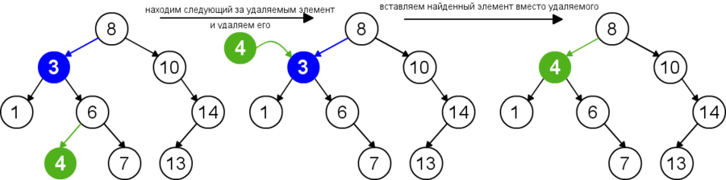

# Раздел 1. Алгоритмы и структуры данных

## *Содержание*

1. Сортировка слиянием (mergesort). Определение числа инверсий в перестановке за O(n log n).
2. Быстрая сортировка (quicksort). Поиск k-й порядковой статистики за линейное в среднем время.
3. Двоичная куча. Пирамидальная сортировка. Построение кучи за линейное время.
4. Хеш-таблицы. Методы разрешения коллизий: метод цепочек, открытая адресация. Универсальное семейство хеш-функций.
5. Амортизированная сложность. Динамический массив и оценка сложности его операций.
6. Динамическое программирование: одномерное, двумерное, на подотрезках, на подмножествах.
7. Двоичные деревья поиска. Preorder, postorder, inorder обходы дерева. Реализация вставки, удаления, поиска.
8. Самобалансирующиеся деревья поиска (рассказать любое на выбор). Реализация и оценка сложности операций вставки, удаления, поиска.
9. Графы. Представление графов в памяти. Обход в ширину. Обход в глубину. Топологическая сортировка.
10. Задача поиска кратчайших путей в графе. Алгоритм Дейкстры. Алгоритм Форда–Беллмана.
11. Задача построения минимального остовного дерева. Алгоритм Крускала. Алгоритм Прима.
12. Задача о максимальном потоке в графе. Теорема Форда–Фалкерсона. Алгоритм Эдмондса–Карпа.
13. Дерево отрезков. Ограничения на поддерживаемую операцию. Запросы модификации на отрезке.
14. Быстрое преобразование Фурье. Применение для умножения длинных чисел и многочленов.
15. Нахождение обратного элемента по модулю. Быстрое возведение в степень. Алгоритм Диффи–Хеллмана для выработки общего секрета.
16. Задача поиска подстроки в строке. Алгоритм Рабина–Карпа. Алгоритм Кнута–Морриса–Пратта.
17. Бор. Алгоритм Ахо–Корасик.

___
## 1. Сортировка слиянием (mergesort). Определение числа инверсий в перестановке за O(n log n).

#### Процедура Merge

*Задача:* Даны два отсортированных массива $a_1 \leq a_2 \leq ... \leq a_n$ и $b_1 \leq b_2 \leq ... \leq b_m$. Надо их слить в один отсортированный массив за $O(n+m)$ времени и доппамяти.

*Алгоритм:*
1. Заведем указатели на первые элементы массивов $i$ и $j$.
2. По индексу $i + j$ выпишем меньший из $a_i$ и $b_j$ и сдвинем соответствующий указатель на один вперед.
3. Так делаем, пока $i < n$ и $j < m$.
4. Оставшийся хвост одного из массивов дописываем в конец.

#### MergeSort

*Задача:* Дан массив $a_1, . . . , a_n$. Необходимо отсортировать его за $O(n \log{n})$ времени и $O(n)$ доппамяти.

*Алгоритм:*
1. Разделим массив на две равные части.
2. Каждую из них рекурсивно отсортируем.
3. Результаты сольем в один отсортированный массив.

#### Подсчёт числа инверсий

***def*** Пара $i < j$ называется *инверсией*, если $a_i > a_j$.

*Задача:* Дан массив $a_1, . . . , a_n$. Необходимо найти число инверсий за $O(n \log{n})$ времени и $O(n)$ доппамяти.

*Решение:*
1. Если при слиянии элемент левой части больше элемента правой части, то значит это и есть инверсия.
2. Пусть мы сравниваем в сортировке слиянием $l[i]$ и $r[j]$, тогда если $r[j] < l[i]$, то $r[j] < l[i] < l[i + 1] < . . . < l[N]$, то есть число инверсий это $N − i$ для $r[j]$.
3. Тогда для одного слияния итоговое число инверсий равно сумме по $j$ таких значений.
4. Итоговый ответ равен сумме по всем слияниям.

__________
## 2. Быстрая сортировка (quicksort). Поиск k-й порядковой статистики за линейное в среднем время.
#### QuickSort

*Цель:* Отсортировать массив $a_1, . . . , a_n$ за $O(n \log{n})$ времени в среднем.

*Алгоритм:*
1. Определённым образом выбрать опорный элемент `pivot`.
2. Произвести процедуру `partition`: все, что меньше `pivot` левее него, а все, что больше – правее.
3. Вызвать рекурсивно от правой и левой половин.

***th*** Среднее время работы быстрой сортировки массива $a_1,a_2, ..., a_N$ при случайном выборе опорного элемента составит $O(N \log{N})$.

$\square$

Будем считать, что в массиве нет повторяющихся элементов. Перенумеруем их таким образом, что $b_i$ – $i$-ый по возрастанию элемент.

Введём случайную величину $C$ – число сравнений: $C = \sum\limits_{i=1}^N \sum\limits_{j > i} C_{i, j}$, где $C_{i,j}$ – бинарная случайная величина, равная единице, если $b_i$ сравнивался с $b_j$. 

Пусть $x$ – опорный элемент, тогда впоследствии не будут сравниваться элементы, попавшие в разные стороны от $x$. При этом $b_i$ сравнивается с $b_j$ только если один из них был выбран опорным элементом. Вероятность, что кто-то был выбран опорным элементом равна $\frac{2}{j - i + 1}$ (всего промежутке $j - i + 1$ элемент). Откуда:

$\mathbb{E}[C] = \sum\limits_{i=1}^N \sum\limits_{j > i} P(C_{i,j} = 1) = \sum\limits_{i=1}^N \sum\limits_{j > i} \frac{2}{j - i + 1} = \sum\limits_{i=1}^N \sum\limits_{k = 1}^{N - i} \frac{2}{k} =^* \sum\limits_{i=1}^N O(\log{N}) = O(N \log{N})$

$*$ из факта $\sum\limits_{i=1}^k \frac{1}{i} = O(\log{k})$

$\blacksquare$

#### Поиск k-ой порядковой статистики

***def*** $k$-ая порядковая статистика массива – такой элемент, что после сортировки массива он окажется на $k$-ом месте.

*Алгоритм:*
1. Выбрать случай опорный элемент.
2. Провести разбиение.
3. Если индекс опорного элемента $i$ окажется больше данного $k$, то ищем слева $k$-ую порядковую, в случае равенства завершаемся, в противном случае – $(i − k − 1)$-ю порядковую.

***th (б/д)*** Время работы этого алгоритма линейно в среднем.

___
## 3. Двоичная куча. Пирамидальная сортировка. Построение кучи за линейное время.

#### Бинарная куча

***def*** *Куча* – структура данных, которая позволяет добавлять в себя элементы и получать или извлекать минимум за логарифмическое время.

***def*** Бинарная куча – структура данных в виде полного бинарного дерева, для которого верно свойство кучи: все дети больше родителя.


*Просеивания:* Процедуры для восстановления свойств кучи при условии, что их нарушает один элемент.
- `siftUp` (просеивание элемента вверх) – процедура, поднимающая элемент как можно выше, пока не выполняется свойство кучи.
- `siftDown` (просеивание элемента вниз) – процедура, погружающая элемент как можно ниже, пока не выполняется свойство кучи.

*Операции:*
- `getMin` – вернуть элемент, находящийся в корне.
- `insert` – подвесить элемент в самое левое свободное место на нижнем уровне и просеять вверх.
- `extractMin` – поменять местами корневой элемент и самый правый лист, лист отрезать, корень просеять вниз.

Бинарная куча может быть представлена как массив. В таком случае:
- Дети узла с индексом $i$ имеют индексы $2i + 1$, $2i + 2$
- Родитель узла с индексом $i$ имеет индекс $\lfloor \frac{i - 1}{2} \rfloor$

#### Построение за линию на массиве (Heapify)

***def*** *Heapify* – функция, строящая кучу на заданном массиве. То есть надо переупорядочить элементы в массиве так, чтобы по индексам на всех парах родитель-сын было соблюдено свойство кучи.

*Алгоритм:* Будем просеивать вниз элементы, начиная с $\frac{N}{2}$-ого до нулевого.

*Корректность:* Вытекает из корректности `siftDown` при корректных поддеревьях.

*Время работы (б/д):* $O(N)$

#### Сортировка кучей (HeapSort)

*Цель:* Отсортировать массив за $O(N\log{N})$ времени и $O(1)$ доппамяти.

*Алгоритм:*
- Выполнить heapify.
- `x = extractMin()`, записываем его в конец массива.
- Повторяем $N-1$ раз.
- Развернуть массив.

___
## 4. Хеш-таблицы. Методы разрешения коллизий: метод цепочек, открытая адресация. Универсальное семейство хеш-функций.

***def*** *Хеш-таблица* – контейнер, способный делать вставку, удаление и поиск в среднем за $O(1)$.

***def*** Пусть $U$ – множество рассматриваемых объектов, тогда $h : U \to \lbrace 0, 1, . . . , k − 1 \rbrace$ называется *хеш-функцией*.

***def*** Элементы $x, y \in U$, где $x \neq y$ образуют коллизию, если $h(x) = h(y)$.

#### Хеш-таблица на цепочках

***def*** *Бакетом* (bucket) называют нечто, хранящее все элементы, образующие коллизию.

Создадим массив некоторой длины $l$, где будем хранить по индексу цепочку из данных. Поиск в цепочке работает за линейное время, поэтому мы хотим уменьшить их максимальную длину.

Рассмотрим величину $L_q$ – длина цепочки, отвечающей ключу $q$. Пусть таблица построена для различных ключей $k_1, ..., k_n$, тогда: $L_q = \sum_{i=1}^{n} I[h(q) = h(k_i)]$

$\mathbb{E} L_q = \mathbb{E} \sum_{i=1}^{n} I[h(q) = h(k_i)] = \sum_{i=1}^{n} P[h(q) = h(k_i)]$

$$
P(h(x) = h(y)) = 
\begin{cases} 
1, & x = y \\ 
\frac{1}{k}, & x \neq y
\end{cases}
$$

С учётом того, что ключи различны:

$\mathbb{E} L_q = \sum_{i=1}^{n} P[h(q) = h(k_i)] \leq 1 + \frac{n-1}{k} \leq 1 + \frac{n}{k}$

***def*** Коэффициентом загруженности (load factor) называют величину $\alpha = \frac{n}{k}$. 

Тогда заведём константу $C$, т.ч. всегда $\alpha \leq C$. При соблюдении этого требования на load factor получим контейнер, выполняющий операции вставки, поиска и удаления за $O(1)$ в среднем.

#### Открытая адресация

Пусть вся хеш-таблица – один массив.


Пришёл $x$, считаем $h(x)$. Если $h(x)$ занят – смотрим следующий.

***def*** Пробой назовём функцию $g(x, i)$. 

То есть это "более умный шаг", например:
- *Линейное пробирование*: $g(x, i) = h(x) + ai + b$
- *Квадратичное пробирование*: $g(x, i) = h(x) + ai^2 + bi + c$
- *Двойное хеширование*: $g(x, i) = h_1(x) + i \cdot h_2(x)$

Операции в хеш-таблице с открытой адресацией:
- *Insert*: Считаем $g(x, i=0) \sim h(x)$. В итоге вставим в $g(x, i=j)$, где $j$ – номер итерации прыжка, на котором нашли свободное место.
- *Lookup*: Идём от $g(x, i=0)$ до пустого, сравнивая в каждой ячейке с $x$. Если дошли до пустой, раньше, чем нашли $x$, то его не было.
- *Erase:* Просто удаление из ячейки может сломать "пути/цепочки поиска" других элементов. Введём новое состояние – $tombstone$. *Insert* будет видеть томбу как пустую ячейку, и сможет поверх неё перезаписать новый элемент. *Lookup* же воспринимает томбу как элемент, и идёт дальше по пробе.

Поддерживаем load factor $\alpha = \frac{n}{m}$. Если $\alpha > 0.5$, то рехеш + реалокация: $m \to 2m, h(x) = H(x) \mod{m} \to h'(x) = H'(x) \mod{2m}$.

Время работы: $O(1)$ в среднем, вставка $O^*(1)$ в среднем.

#### Универсальное семейство хеш-функций

***def*** $\mathcal{H}$ – универсальное семейство хеш-функций: $\forall x, y \in U, \ x \neq y : \quad P_{h \in \mathcal{H}}(h(x) = h(y)) \leq \frac{1}{m}$, где $h$ выбирается из $\mathcal{H}$ равновероятно. Другими словами, для любых $x \neq y$ функций с коллизией на этой паре не больше $|\mathcal{H}|/m$.

*Пример*: $U \subset \lbrace 0, \space 1, \space ..., K-1 \rbrace$; $p$ – простое, $p > K$;  $\mathcal{H} = \lbrace h_{a,b}(x) = ((ax + b) \mod{p})\mod{m} \rbrace$, $a \in \lbrace 1, 2, ..., p-1 \rbrace, b \in \mathbb{Z}_p$

***st*** Данное семейство универсально.

$\square$
В семействе $|\mathcal{H}| = p(p-1)$ функций.

Зафиксируем ключи $x \neq y$ и обозначим

$$r = (ax + b) \bmod p, \qquad s = (ay + b) \bmod p.$$

Тогда $h_{a,b}(x) = h_{a,b}(y) \iff r \equiv s \pmod m$.

***Шаг 1*. На первом этапе (mod $p$) коллизий нет: $r \neq s$.**

Имеем $r - s \equiv a(x - y) \pmod p$. Здесь $a \not\equiv 0$, и $x - y \not\equiv 0 \pmod p$, потому что $x, y \in \mathbb{Z}_p$ и $x \neq y$. Так как $p$ простое, в $\mathbb{Z}_p$ нет делителей нуля, и произведение двух ненулевых вычетов ненулевое. Значит, $r \neq s$, и все коллизии возникают только при взятии по модулю $m$.

***Шаг 2.* При фиксированных $x, y$ отображение $(a, b) \mapsto (r, s)$ – биекция между парами $(a, b)$ с $a \neq 0$ и парами $(r, s)$ с $r \neq s$.**

По определению $(r, s)$ – это решение системы над $\mathbb{Z}_p$:

$$
\begin{pmatrix}
x & 1 \\ y & 1
\end{pmatrix}

\begin{pmatrix}
a \\ b
\end{pmatrix}

=

\begin{pmatrix}
r \\ s
\end{pmatrix}

, \space

\begin{vmatrix}
x & 1 \\ y & 1
\end{vmatrix}

= x - y \neq 0
$$

Матрица обратима над $\mathbb{Z}_p$, поэтому для любой пары $r \neq s$ существует ровно одна пара $(a, b)$:

$$a = (r - s)(x - y)^{-1} \bmod p, \qquad b = (r - ax) \bmod p,$$

причём $a \neq 0$, так как $r \neq s$. Вместе с шагом 1 получаем биекцию.

***Следствие:*** если $h_{a,b}$ выбирается из $\mathcal{H}$ равновероятно, то пара $(r, s)$ равновероятно распределена по $p(p-1)$ упорядоченным парам различных вычетов. Поэтому

$$P_{h \in \mathcal{H}}(h(x) = h(y)) = \frac{\#\bigl\{(r, s) : r \neq s,\ r \equiv s \pmod m\bigr\}}{p(p-1)}.$$

***Шаг 3.* Подсчёт пар с коллизией.** Значение $r$ можно выбрать $p$ способами. Среди чисел $0, \dots, p-1$ не больше $\lceil p/m \rceil$ имеют тот же остаток по модулю $m$, что и $r$. Без самого $r$ для $s$ остаётся не больше

$$\left\lceil \frac{p}{m} \right\rceil - 1 \;\le\; \frac{p + m - 1}{m} - 1 \;=\; \frac{p - 1}{m}$$

вариантов. Итого пар с коллизией не больше $p \cdot \frac{p-1}{m}$, и

$$P_{h \in \mathcal{H}}(h(x) = h(y)) \;\le\; \frac{p(p-1)/m}{p(p-1)} \;=\; \frac{1}{m}.$$
$\blacksquare$

___
## 5. Амортизированная сложность. Динамический массив и оценка сложности его операций.

***def*** Пусть имеется некоторая последовательность операций, каждая из которых выполняется за время $t_i$, тогда *амортизированная стоимость* операции $t^* = \frac{1}{n} \sum\limits_{i=1}^n t_i$

Амортизированная сложность обозначается $O^* (f(n))$. Для доказательства амортизированной сложности применяется метод монеток (бухучёт) или метод потенциалов.

*Метод монеток:*
- Допустим, что каждая операция стоит определенной количество монет $C_i$ – учётная стоимость операции.
- Учётная стоимость не менее реальной. Оставшиеся монеты мы кладём в резерв, чтобы в будущем оплатить тяжёлую операцию.

*Метод потенциалов:*

***def*** Потенциалом от структуры $S$ назовём такую функцию $\phi(S)$, что:
- $\phi(S_0) = 0$, где $S_0$ – изначальное состояние структуры;
- $\phi(S) > 0$ в любой момент времени.

***def*** Пусть $t_i$ – реальное время $i$-ой операции, тогда $t_i^* = t_i + \phi(S_i) - \phi(S_{i-1})$ – учётное время.

***st*** $\frac{1}{n} \sum\limits_{i=1}^{n} t_i^* \geq t^*$

#### Динамический массив

***def*** *Динамически расширяющийся массив* (далее везде буду называть *вектор*) – массивоподобная структура, предлагающая следующий интерфейс:
- `push_back(n)` – добавить значение `n` в конец вектора.
- `pop()` – возвращает значение в конце вектора и удаляет его.
- `get(i)` – получить значение по индексу `i`

*Реализация на массиве:* у нас есть массив `T[] data`, его максимальная вместимость `cap = data.length` и нынешняя длина `size`.
- При добавлении элемента в конец перезаписываем его поверх `data[size]` и `size += 1`. При удалении с конца `size -= 1`.
- Если добавляем в конец, но `size == cap`, то создаём новый массив `T[]` длины `cap*2`, и перезапишем в него `size` элементов из старого массива. Потом как обычно добавляем.
- Если удаляем с конца и вышло, что `size < cap / 4`, то создаём новый массив длины `cap/2`, и перезаписываем туда элементы.

*Амортизационный анализ (методом монеток)*:

Рассмотрим на примере `push_back` в векторе, `pop` аналогично:
- При добавлении элемента платим 3 монетки – одну за запись в массив, и две в резерв.
- Инвариант: к следующей реаллокации у нас монет в резерве не меньше, чем элементов.
- При реаллокации платим `cap` монеток на перемещение элементов. Повторные реаллокации будут оплачены резервом с добавления `cap` значений в правую половину.

___
##  6. Динамическое программирование: одномерное, двумерное, на подотрезках, на подмножествах.

***def*** *Динамическое программирование* – подход к решению задач, где рассматривается сведение подзадачи к меньшей с оптимизированным перебором возможных вариантов.

Пять шагов для решения задач на ДП:
1. Что хранит в себе состояние динамики?
2. База.
3. Как пересчитывать?
4. Порядок пересчёта.
5. Где лежит ответ?

### Одномерное ДП

В одномерных задачах ДП: $dp$ – одномерный массив состояний, где $i$-ое состояние зависит от всех предыдущих, т.е. $dp = f(dp[i-1], ..., dp[1], dp[0])$.

Рассмотрим примеры таких задач:

#### Числа Фибоначчи

Найти первые $n$ чисел Фибоначчи.

Решение: $dp[i]$ – $i$-ое число Фибоначчи. $dp[0]=dp[1]=1$, $dp[i] = dp[i-1] + dp[i-2]$.

#### Задача о Кузнечике

Дан массив $a_1, ..., a_n$. Находясь изначально в $a_0 = 0$ необходимо допрыгать до $a_n$, максимизировав сумму $a_i$, в которых побывал кузнечик. Он может прыгать на 1 или 2 клетки вперёд.
  
Решение:
1. Пусть $dp[i]$ – ответ для первых $i$ клеток.
2. База: $dp[0] = 0, dp[1] = a_1$.
3. Переход $dp[i] = a_i + max(dp[i-1], dp[i-2])$.
4. Цикл по $i$.
5. Ответ в $dp[n]$.

#### Задача о Наибольшей возрастающей последовательности

Дан массив $a_1, . . . , a_n$. Необходимо извлечь наибольшую по длине возрастающую подпоследовательность. То есть найти такие индексы $1 \leq i_1 < i_2 < . . . < i_k \leq n$, что $a_{i_j} < a_{i_{j+1}}$ и $k$ максимально.
  
Решение: 
1. Пусть $dp[i]$ – длина НВП, кончающейся в $a_i$.
2. База $dp[:] = 1$.
3. Шаг $dp[i] = 1 + \underset{j<i, a_j < a_i}{max} dp[j]$.
4. Цикл по $i$.
5. Ответ: $max(dp)$.

*Восстановление ответа:* держим массив родителей и индекс конца НВП, потом по ним за $max(dp)$ шагов получаем последовательность.

### Двумерное ДП

В двумерных задачах ДП: $dp$ – двумерный массив состояний, где $(i, j)$-ое состояние зависит от всех предыдущих, т.е. $dp = f(dp[i-1][j], dp[i][j-1], ...)$.

Рассмотрим примеры таких задач:

#### Наибольшая общая подпоследовательность

Даны два массива $a_1, . . . , a_n$ и $b_1, . . . , b_m$. Необходимо извлечь наибольшую по длине общую подпоследовательность. То есть найти такие индексы $1 \leq i_1 < . . . < i_k \leq n$ и $1 \leq j_1 < . . . < j_k \leq m$, что $a_{i_l} = b_{j_l}$ и $k$ максимально.
  
Решение: 

1. Пусть $dp[i][j]$ – ответ для $a[:i], b[:j]$. 
2. База: $dp[:][:] = 0$.
3. Переход:

$$
dp[i][j] = max
\begin{cases}
dp[i-1][j-1] + 1, & a_i = b_j \\
max(dp[i-1][j], dp[i][j-1]), & \text{иначе}
\end{cases}
$$

4. Порядок пересчёта: `for i in range(1, n+1): for j in range(1, m+1):`
5. Ответ в $dp[n][m]$.

*Восстановление ответа:* Длина лежит в $dp[n][m]$, члены можно найти, идя обратно по правилам для $dp[i][j]$, стартуя из $i=n, j=m$. Если $a_i = b_j$, то нашли следующий с конца член и идём в $(i-1, j-1)$, иначе делаем шаг по горизонтали или вертикали по выбранному для $dp[i][j]$ правилу.

#### Рюкзак (0/1) 

Даны два вектора $w = (w_0, . . . ,w_{n−1})$ и $c = (c_0, . . . , c_{n−1})$, оба вектора
из $\mathbb{N}^n$. Нужно за $O(nW)$ построить битовый вектор $b \in \lbrace 0, 1\rbrace^n$ такой, что

$$
\begin{cases}
(w, b) \leq W \\ (c, b) \to max
\end{cases}
$$
*т.е. выбрать в рюкзак предметы не выше определённого веса, чтобы стоимость была максимальна*.

Решение:

1. Пусть $dp[i][v]$ – ответ, если разрешено брать только первые $i$ предметов, а ограничение по весу в рюкзаке $v$.
2. База: $dp[:][:] = 0$
3. Переход:
$$
dp[i][v] = max
\begin{cases}
dp[i-1][v], & i\text{-ый предмет НЕ берём} \\
dp[i-1][v - w_i] + c_i, & i\text{-ый предмет берём, } w_i \leq v
\end{cases}
$$
4. Порядок пересчёта: `for i in range(1, n+1): for v in range(1, W+1)`
5. Ответ в $dp[n][W]$.

*Восстановление ответа*: тоже по правилам, стартуя от $i=n, v=W$, $i$ убывает в цикле. Если $dp[i][v] = dp[i-1][v]$, то $i$-ый предмет можно не брать, иначе $b_i = 1$ и уменьшаем $v$ на $w_i$.

### ДП на подотрезках

Если имеется способ расчета ответ на задачу на основе ответов на подотреках, то для решения таковой задачи выгодно сделать следующее:

1. $dp[l,r]$ – ответ на задачу на подотрезке $[l,r]$.
2. Задать базу для отрезков длины 1, 2.
3. Определить функцию "слияния" ответов. То есть как получить из результатов на подотрезках результат для всего отрезка.
4. Порядок пересчёта – по возрастанию длины

#### Подпоследовательность-палиндром

Есть строка $S$. Надо найти длину максимальной подпоследовательности палиндрома за $O(|S|^2)$.

*Решение*:

Данная постановка предполагает, что ответ для отрезка $[l,r]$ можно извлечь из отрезков $[l + 1,r]$, $[l,r − 1]$, $[l + 1,r − 1]$.

1. Пусть $dp[i][j]$ – максимальная длина подпоследовательности-палиндрома в подстроке $S[i:j+1]$
2. База: $dp[l][l] = 1$ и $dp[l][r] = 0$, если $r < l$.
3. Пересчёт:
   - Если $S[l] = S[r]$, то оба символа докинем в ответ и $dp[l][r] = dp [l + 1][r − 1] + 2$. При корректной базе, корректность перехода доказывается по индукции.
   - Если $S[l] \neq S[r]$, то $dp[l][r] = max(dp[l+1][r], dp[l][r-1])$.
4. Верхний цикл по длине: `for len in range(2, S.size() + 1)`, нижний по началу подстроки: `for l in range(0, S.size() - len + 1)`: `r = l + len - 1`
5. Ответ в $dp[0][|S| − 1]$.

#### Правильная скобочная подпоследовательность

Есть строка $S$, $n = |S|$, из скобок нескольких типов (`()`, `[]`, `{}`). Надо найти длину максимальной правильной скобочной подпоследовательности (ПСП) за $O(n^3)$.

*Решение*:

Будем искать не саму ПСП, а минимальное число символов, которые надо удалить, чтобы осталась ПСП. Тогда ответ – $n$ минус это число.

Идея: смотрим на первый символ отрезка $S[l]$. Есть два варианта:
- $S[l]$ удаляется;
- $S[l]$ остаётся, и тогда у него есть парная закрывающая скобка $S[m]$, $m \in [l+1, r]$. ПСП разбивается на часть внутри пары и часть после неё: `S[l] + (ПСП на [l+1, m-1]) + S[m] + (ПСП на [m+1, r])`. Эти части правильные независимо друг от друга, поэтому получаются две подзадачи на меньших отрезках.

1. Пусть $dp[l][r]$ – минимальное число символов, которые надо удалить из $S[l:r+1]$, чтобы осталась ПСП.
2. База: $dp[l][l] = 1$ (одиночную скобку всегда удаляем), $dp[l][r] = 0$ при $r < l$ (пустая строка – ПСП).
3. Переход:
$$
dp[l][r] = \min\left(dp[l+1][r] + 1,\ \underset{\substack{m \in [l+1, r] \\ S[l],\, S[m] \text{ – пара}}}{\min}\big(dp[l+1][m-1] + dp[m+1][r]\big)\right)
$$
   где "пара" значит: $S[l]$ – открывающая, $S[m]$ – закрывающая того же типа. Первый аргумент – удаляем $S[l]$, второй – оставляем его в паре с $S[m]$. При $m = r$ часть после пары пустая: $dp[r+1][r] = 0$.
4. Порядок пересчёта – по возрастанию длины отрезка:
```
for len in range(2, n + 1):  
for l in range(0, n - len + 1):  
r = l + len - 1  
for m in range(l + 1, r + 1):
```
5. Ответ: $n - dp[0][n-1]$.  

### ДП на подмножествах

Далее работаем с двоичными числами длины N. Доступны следующие операции:
- Побитовое ИЛИ. $a | b$
- Побитовое И. $a \& b$
- Побитовое ВЗАИМОИСКЛЮЧАЮЩЕЕ ИЛИ. $a ∧ b$
- Побитовая ИНВЕРСИЯ. $\sim a$
- Побитовый СДВИГ влево или вправо. $a << 1$ или $a >> 1$

Рассмотрим множество $\lbrace0, 1, . . . , n − 1\rbrace$. Тогда можно закодировать все возможные подмножества двоичной строкой длины $n$ или числами до $2^n$. Если элемент $i$ в подмножестве, то вместо $i$-го бита будем ставить единичку, иначе ноль.

Тогда операции с подмножествами записываются как:
- $A \cup B$ это $A | B$
- $A \cap B$ это $A \& B$
- $\neg{A}$ это $\sim A$

#### Рюкзак (0/1) на масках

Та же задача, решаемая перебором всех подмножеств предметов. Подмножество кодируется маской $mask \in [0, 2^n)$: $i$-й бит равен 1, если $i$-й предмет взят, т.е. маска совпадает с искомым вектором $b$. ДП здесь нужно, чтобы считать вес и стоимость подмножества за $O(1)$ по подмножеству на один предмет меньше.

1. Пусть $dp[mask] = \sum_{i \in mask} c_i$, если $w(mask) = \sum\limits_{i \in mask} w_i \leq W$, и $dp[mask] = -\infty$ иначе. Веса $w(mask)$ храним в отдельном массиве.
2. База: $dp[0] = 0$, $w(0) = 0$, остальные $dp[mask] = -\infty$.
3. Переход: расширяем $mask$ на один предмет $i \notin mask$, $w(mask \mid (1 << i)) = w(mask) + w_i$ и
$$
dp[mask \mid (1 << i)] = \begin{cases} -\infty, & w(mask) + w_i > W \\ dp[mask] + c_i, & \text{иначе} \end{cases}
$$
4. Порядок пересчёта: маски по возрастанию, начиная с 0. При $i \notin mask$ верно $mask \mid (1 << i) > mask$, поэтому все маски, из которых приходим в текущую, уже посчитаны.
5. Ответ: $\underset{mask}{\max}\, dp[mask]$; маска, на которой он достигается, и есть $b$.

Асимптотика: $O(2^n \cdot n)$ по времени ($2^n$ масок, из каждой до $n$ переходов), $O(2^n)$ по памяти. В отличие от $O(nW)$ не зависит от $W$, поэтому метод выгоден при малом $n$ (до $\sim 20$) и большом $W$.

#### Задача коммивояжёра

Дан полный граф на $n$ вершинах с весами рёбер $w(u, v)$. Надо обойти все вершины, посетив каждую ровно один раз, с минимальным суммарным весом рёбер, т.е. найти гамильтонов путь минимального веса.

Перебор всех порядков обхода стоит $O(n!)$. Ключевое наблюдение: для продолжения пути важны только *множество* уже посещённых вершин и *последняя* из них, а порядок посещения остальных на продолжение не влияет. Поэтому достаточно $2^n \cdot n$ состояний.

1. Пусть $dp[mask][v]$ – минимальный вес пути, который посещает ровно вершины из $mask$ (каждую по разу) и заканчивается в $v \in mask$.
2. База: $dp[1 << v][v] = 0$ для всех $v$ (начать можно где угодно), остальные $+\infty$.
3. Переход: дописываем к пути вершину $u \notin mask$:
$$
dp[mask \mid (1 << u)][u] = \min\left(dp[mask \mid (1 << u)][u],\ \underset{v \in mask}{\min}\big(dp[mask][v] + w(v, u)\big)\right)
$$
4. Порядок пересчёта: маски по возрастанию, т.к. $mask \mid (1 << u) > mask$.
5. Ответ: $\underset{v}{\min}\, dp[2^n - 1][v]$.

*Восстановление ответа:* храним $parent[mask][u] = v$, на котором достигнут минимум, и идём от $(2^n - 1, v^*)$ назад, убирая из маски текущую вершину.

Асимптотика: $O(2^n \cdot n^2)$ по времени ($2^n \cdot n$ состояний, переход за $O(n)$), $O(2^n \cdot n)$ по памяти. При $n = 20$ это $\sim 4 \cdot 10^8$ операций против $20! \approx 2.4 \cdot 10^{18}$ у перебора.

___
## 7. Двоичные деревья поиска. Preorder, postorder, inorder обходы дерева. Реализация вставки, удаления, поиска.

### Двоичные деревья поиска. Реализация вставки, удаления, поиска.

***def*** *Бинарным (Двоичным) деревом поиска* называют бинарное дерево, в котором в поддереве левее все элементы не больше элемента в данном узле, а в поддереве правее – строго больше.

Операции в дереве поиска: поиск, вставка, удаление за $O(h)$, где $h$ – высота дерева.

В наивной реализации без балансировок:
- *Поиск*: Начиная с корня, сравниваем со значением в узле. Если не совпало, идём в нужное поддерево.
- *Вставка*: Начиная с корня, сравниваем со значением в узле, идём в нужное поддерево, пока не придём в несуществующий узел. На его место подвешиваем новый.
- *Удаление*: Ищем узел. Если у него нет детей – просто удаляем, если 1 сын – подвешиваем на его место, если 2 сына, то подвешиваем вместо корня самого левого сына правого поддерева (если у того узла был правый сын, то он подвешивается к родителю):



Проблема простых деревьев – $O(N)$ высота в худшем случае (бамбук).

### Preorder, postorder, inorder обходы дерева.

Обход дерева – посещение всех его узлов в определённом порядке. Выделяют три основных обхода:
- **Preorder (прямой обход)**: сначала обрабатываем текущий узел, затем рекурсивно обходим левое и правое поддеревья. *Корень -> Лево -> Право*.
- **Inorder (симметричный обход)**: сначала рекурсивно обходим левое поддерево, затем обрабатываем текущий узел, затем обходим правое поддерево. *Лево -> Корень -> Право*. Для бинарного дерева поиска получаем элементы в порядке неубывания.
- **Postorder (обратный обход)**: сначала рекурсивно обходим левое и правое поддеревья, затем обрабатываем текущий узел. *Лево -> Право -> Корень.

Каждый обход занимает $O(N)$ времени, так как посещает каждый узел ровно один раз. При рекурсивной реализации требуется $O(h)$ дополнительной памяти под стек вызовов, где $h$ – высота дерева.

___


