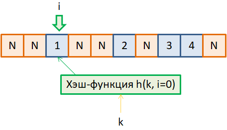

# Раздел 1. Алгоритмы и структуры данных

## *Содержание*

1. Сортировка слиянием (mergesort). Определение числа инверсий в перестановке за O(n log n).
2. Быстрая сортировка (quicksort). Поиск k-й порядковой статистики за линейное в среднем время.
3. Двоичная куча. Пирамидальная сортировка. Построение кучи за линейное время.
4. Хеш-таблицы. Методы разрешения коллизий: метод цепочек, открытая адресация. Универсальное семейство хеш-функций.
5. Амортизированная сложность. Динамический массив и оценка сложности его операций.
6. Динамическое программирование: одномерное, двумерное, на подотрезках, на подмножествах.
7. Двоичные деревья поиска. Preorder, postorder, inorder обходы дерева. Реализация вставки, удаления, поиска.
8. Самобалансирующиеся деревья поиска (рассказать любое на выбор). Реализация и оценка сложности операций вставки, удаления, поиска.
9. Графы. Представление графов в памяти. Обход в ширину. Обход в глубину. Топологическая сортировка.
10. Задача поиска кратчайших путей в графе. Алгоритм Дейкстры. Алгоритм Форда–Беллмана.
11. Задача построения минимального остовного дерева. Алгоритм Крускала. Алгоритм Прима.
12. Задача о максимальном потоке в графе. Теорема Форда–Фалкерсона. Алгоритм Эдмондса–Карпа.
13. Дерево отрезков. Ограничения на поддерживаемую операцию. Запросы модификации на отрезке.
14. Быстрое преобразование Фурье. Применение для умножения длинных чисел и многочленов.
15. Нахождение обратного элемента по модулю. Быстрое возведение в степень. Алгоритм Диффи–Хеллмана для выработки общего секрета.
16. Задача поиска подстроки в строке. Алгоритм Рабина–Карпа. Алгоритм Кнута–Морриса–Пратта.
17. Бор. Алгоритм Ахо–Корасик.

___
## 1. Сортировка слиянием (mergesort). Определение числа инверсий в перестановке за O(n log n).

#### Процедура Merge

*Задача:* Даны два отсортированных массива $a_1 \leq a_2 \leq ... \leq a_n$ и $b_1 \leq b_2 \leq ... \leq b_m$. Надо их слить в один отсортированный массив за $O(n+m)$ времени и доппамяти.

*Алгоритм:*
1. Заведем указатели на первые элементы массивов $i$ и $j$.
2. По индексу $i + j$ выпишем меньший из $a_i$ и $b_j$ и сдвинем соответствующий указатель на один вперед.
3. Так делаем, пока $i < n$ и $j < m$.
4. Оставшийся хвост одного из массивов дописываем в конец.

#### MergeSort

*Задача:* Дан массив $a_1, . . . , a_n$. Необходимо отсортировать его за $O(n \log{n})$ времени и $O(n)$ доппамяти.

*Алгоритм:*
1. Разделим массив на две равные части.
2. Каждую из них рекурсивно отсортируем.
3. Результаты сольем в один отсортированный массив.

#### Подсчёт числа инверсий

***def*** Пара $i < j$ называется *инверсией*, если $a_i > a_j$.

*Задача:* Дан массив $a_1, . . . , a_n$. Необходимо найти число инверсий за $O(n \log{n})$ времени и $O(n)$ доппамяти.

*Решение:*
1. Если при слиянии элемент левой части больше элемента правой части, то значит это и есть инверсия.
2. Пусть мы сравниваем в сортировке слиянием $l[i]$ и $r[j]$, тогда если $r[j] < l[i]$, то $r[j] < l[i] < l[i + 1] < . . . < l[N]$, то есть число инверсий это $N − i$ для $r[j]$.
3. Тогда для одного слияния итоговое число инверсий равно сумме по $j$ таких значений.
4. Итоговый ответ равен сумме по всем слияниям.

__________
## 2. Быстрая сортировка (quicksort). Поиск k-й порядковой статистики за линейное в среднем время.
#### QuickSort

*Цель:* Отсортировать массив $a_1, . . . , a_n$ за $O(n \log{n})$ времени в среднем.

*Алгоритм:*
1. Определённым образом выбрать опорный элемент `pivot`.
2. Произвести процедуру `partition`: все, что меньше `pivot` левее него, а все, что больше – правее.
3. Вызвать рекурсивно от правой и левой половин.

***th*** Среднее время работы быстрой сортировки массива $a_1,a_2, ..., a_N$ при случайном выборе опорного элемента составит $O(N \log{N})$.

$\square$

Будем считать, что в массиве нет повторяющихся элементов. Перенумеруем их таким образом, что $b_i$ – $i$-ый по возрастанию элемент.

Введём случайную величину $C$ – число сравнений: $C = \sum\limits_{i=1}^N \sum\limits_{j > i} C_{i, j}$, где $C_{i,j}$ – бинарная случайная величина, равная единице, если $b_i$ сравнивался с $b_j$. 

Пусть $x$ – опорный элемент, тогда впоследствии не будут сравниваться элементы, попавшие в разные стороны от $x$. При этом $b_i$ сравнивается с $b_j$ только если один из них был выбран опорным элементом. Вероятность, что кто-то был выбран опорным элементом равна $\frac{2}{j - i + 1}$ (всего промежутке $j - i + 1$ элемент). Откуда:

$\mathbb{E}[C] = \sum\limits_{i=1}^N \sum\limits_{j > i} P(C_{i,j} = 1) = \sum\limits_{i=1}^N \sum\limits_{j > i} \frac{2}{j - i + 1} = \sum\limits_{i=1}^N \sum\limits_{k = 1}^{N - i} \frac{2}{k} =^* \sum\limits_{i=1}^N O(\log{N}) = O(N \log{N})$

$*$ из факта $\sum\limits_{i=1}^k \frac{1}{i} = O(\log{k})$

$\blacksquare$

#### Поиск k-ой порядковой статистики

***def*** $k$-ая порядковая статистика массива – такой элемент, что после сортировки массива он окажется на $k$-ом месте.

*Алгоритм:*
1. Выбрать случай опорный элемент.
2. Провести разбиение.
3. Если индекс опорного элемента $i$ окажется больше данного $k$, то ищем слева $k$-ую порядковую, в случае равенства завершаемся, в противном случае – $(i − k − 1)$-ю порядковую.

***th (б/д)*** Время работы этого алгоритма линейно в среднем.

___
## 3. Двоичная куча. Пирамидальная сортировка. Построение кучи за линейное время.

#### Бинарная куча

***def*** *Куча* – структура данных, которая позволяет добавлять в себя элементы и получать или извлекать минимум за логарифмическое время.

***def*** Бинарная куча – структура данных в виде полного бинарного дерева, для которого верно свойство кучи: все дети больше родителя.

*Просеивания:* Процедуры для восстановления свойств кучи при условии, что их нарушает один элемент.
- `siftUp` (просеивание элемента вверх) – процедура, поднимающая элемент как можно выше, пока не выполняется свойство кучи.
- `siftDown` (просеивание элемента вниз) – процедура, погружающая элемент как можно ниже, пока не выполняется свойство кучи.

*Операции:*
- `getMin` – вернуть элемент, находящийся в корне.
- `insert` – подвесить элемент в самое левое свободное место на нижнем уровне и просеять вверх.
- `extractMin` – поменять местами корневой элемент и самый правый лист, лист отрезать, корень просеять вниз.

Бинарная куча может быть представлена как массив. В таком случае:
- Дети узла с индексом $i$ имеют индексы $2i + 1$, $2i + 2$
- Родитель узла с индексом $i$ имеет индекс $\lfloor \frac{i - 1}{2} \rfloor$

#### Построение за линию на массиве (Heapify)

***def*** *Heapify* – функция, строящая кучу на заданном массиве. То есть надо переупорядочить элементы в массиве так, чтобы по индексам на всех парах родитель-сын было соблюдено свойство кучи.

*Алгоритм:* Будем просеивать вниз элементы, начиная с $\frac{N}{2}$-ого до нулевого.

*Корректность:* Вытекает из корректности `siftDown` при корректных поддеревьях.

*Время работы (б/д):* $O(N)$

#### Сортировка кучей (HeapSort)

*Цель:* Отсортировать массив за $O(N\log{N})$ времени и $O(1)$ доппамяти.

*Алгоритм:*
- Выполнить heapify.
- `x = extractMin()`, записываем его в конец массива.
- Повторяем $N-1$ раз.
- Развернуть массив.

___
## 4. Хеш-таблицы. Методы разрешения коллизий: метод цепочек, открытая адресация. Универсальное семейство хеш-функций.

***def*** *Хеш-таблица* – контейнер, способный делать вставку, удаление и поиск в среднем за $O(1)$.

***def*** Пусть $U$ – множество рассматриваемых объектов, тогда $h : U \to \lbrace 0, 1, . . . , k − 1 \rbrace$ называется *хеш-функцией*.

***def*** Элементы $x, y \in U$, где $x \neq y$ образуют коллизию, если $h(x) = h(y)$.

#### Хеш-таблица на цепочках

***def*** *Бакетом* (bucket) называют нечто, хранящее все элементы, образующие коллизию.

Создадим массив некоторой длины $l$, где будем хранить по индексу цепочку из данных. Поиск в цепочке работает за линейное время, поэтому мы хотим уменьшить их максимальную длину.

Рассмотрим величину $L_q$ – длина цепочки, отвечающей ключу $q$. Пусть таблица построена для различных ключей $k_1, ..., k_n$, тогда: $L_q = \sum_{i=1}^{n} I[h(q) = h(k_i)]$

$\mathbb{E} L_q = \mathbb{E} \sum_{i=1}^{n} I[h(q) = h(k_i)] = \sum_{i=1}^{n} P[h(q) = h(k_i)]$

$$
P(h(x) = h(y)) = 
\begin{cases} 
1, & x = y \\ 
\frac{1}{k}, & x \neq y
\end{cases}
$$

С учётом того, что ключи различны:

$\mathbb{E} L_q = \sum_{i=1}^{n} P[h(q) = h(k_i)] \leq 1 + \frac{n-1}{k} \leq 1 + \frac{n}{k}$

***def*** Коэффициентом загруженности (load factor) называют величину $\alpha = \frac{n}{k}$. 

Тогда заведём константу $C$, т.ч. всегда $\alpha \leq C$. При соблюдении этого требования на load factor получим контейнер, выполняющий операции вставки, поиска и удаления за $O(1)$ в среднем.

#### Открытая адресация

Пусть вся хеш-таблица – один массив.

Пришёл $x$, считаем $h(x)$. Если $h(x)$ занят – смотрим следующий.

***def*** Пробой назовём функцию $g(x, i)$. 

То есть это "более умный шаг", например:
- *Линейное пробирование*: $g(x, i) = h(x) + ai + b$
- *Квадратичное пробирование*: $g(x, i) = h(x) + ai^2 + bi + c$
- *Двойное хеширование*: $g(x, i) = h_1(x) + i \cdot h_2(x)$

Операции в хеш-таблице с открытой адресацией:
- *Insert*: Считаем $g(x, i=0) \sim h(x)$. В итоге вставим в $g(x, i=j)$, где $j$ – номер итерации прыжка, на котором нашли свободное место.
- *Lookup*: Идём от $g(x, i=0)$ до пустого, сравнивая в каждой ячейке с $x$. Если дошли до пустой, раньше, чем нашли $x$, то его не было.
- *Erase:* Просто удаление из ячейки может сломать "пути/цепочки поиска" других элементов. Введём новое состояние – $tombstone$. *Insert* будет видеть томбу как пустую ячейку, и сможет поверх неё перезаписать новый элемент. *Lookup* же воспринимает томбу как элемент, и идёт дальше по пробе.

Поддерживаем load factor $\alpha = \frac{n}{m}$. Если $\alpha > 0.5$, то рехеш + реалокация: $m \to 2m, h(x) = H(x) \mod{m} \to h'(x) = H'(x) \mod{2m}$.

Время работы: $O(1)$ в среднем, вставка $O^*(1)$ в среднем.

#### Универсальное семейство хеш-функций

***def*** $\mathcal{H}$ – универсальное семейство хеш-функций: $\forall h \in \mathcal{H}, \forall x \neq y \hookrightarrow P(h(x) = h(y)) \leq \frac{1}{m}$

*Пример*: $\mathcal{H} = \lbrace h_{a,b}(x) = ((ax + b) \mod{p})\mod{m} \rbrace$, где $p$ – простое, $p > \vert Keys \vert$, $a \in \lbrace 1, 2, ..., p-1 \rbrace, b \in \mathbb{Z}_p$

***st*** Данное семейство универсально.

$\square$

$ax + b \equiv ay + b \space \mod{p}$ $\iff$ $ax \equiv ay \space \mod{p}$ $\iff$ $a$ взаимно просто $p$ $\iff$ $x \equiv y \space \mod{p}$ $\iff$ (т.к. $x, y \in \mathbb{Z}_{\vert Keys \vert} \subset \mathbb{Z}_p$) $x = y$ противоречие.

$\implies$ Коллизий на первом этапе нет.

$$
\begin{cases} 
ax+b = c_1 \\ 
ax+b = c_2
\end{cases}

\iff

\begin{pmatrix}
x & 1 \\ y & 1
\end{pmatrix}

\begin{pmatrix}
a \\ b
\end{pmatrix}

=

\begin{pmatrix}
c_1 \\ c_2
\end{pmatrix}

\iff

\begin{pmatrix}
a \\ b
\end{pmatrix}

=

\begin{pmatrix}
x & 1 \\ y & 1
\end{pmatrix}^{-1}

\begin{pmatrix}
c_1 \\ c_2
\end{pmatrix}
$$

$$
\begin{vmatrix}
x & 1 \\ y & 1
\end{vmatrix}

= x - y \neq 0

\implies

\exists

\begin{pmatrix}
x & 1 \\ y & 1
\end{pmatrix}^{-1}
$$

$\implies$ По $c_1, c_2, x, y$ восстанавливаются $a, b$, то есть биекция $(x, y) \leftrightarrow (a, b)$

Зафиксируем $(a, b)$ и посчитаем число $(x, y)$: $h(x) = h(y)$. Всего пар ключей $< p^2$, считаем число пар, дающих коллизию: фикс. $x$ – $p$ способов. Число $y: h(x) = h(y) \iff x = y \mod{m} \sim \frac{p}{m}$ 

$\underset{h \in \mathcal{H}}{P} (h(x) = h(y)) = P_{x, y} (h(x) = h(y)) = \frac{p \cdot \frac{p}{m}}{p} = \frac{1}{m}$

$\blacksquare$

___
