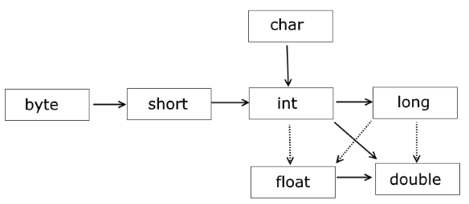
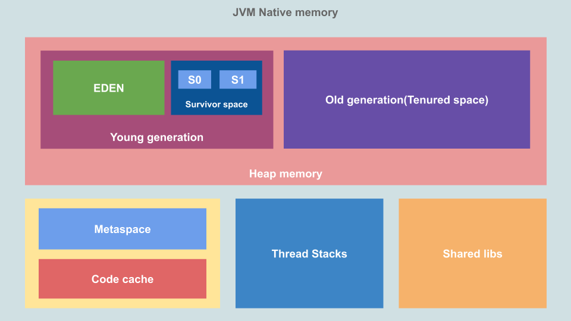
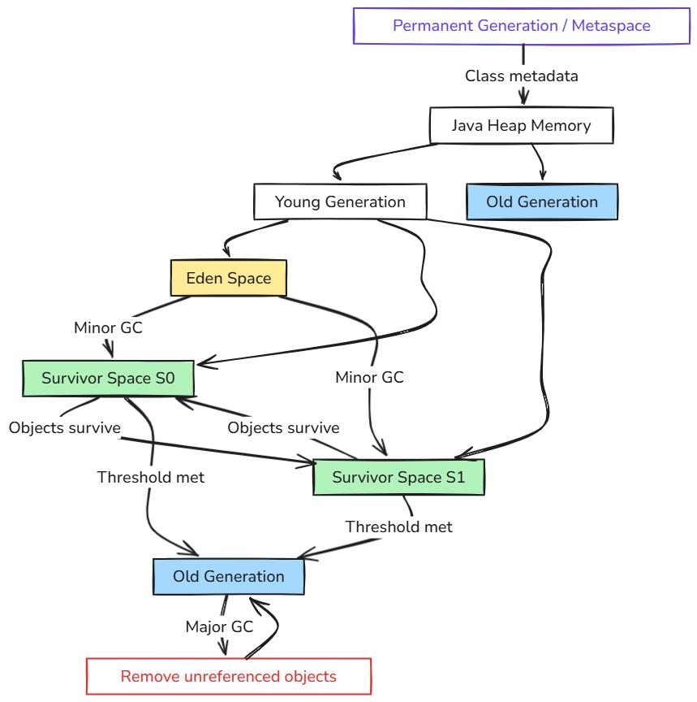

## *Содержание*

1. Фундаментальные типы данных. Целочисленные типы, представление отрицательных чисел. Числа с плавающей точкой, их двоичное представление. Символьный и логический типы. Явные и неявные приведения типов. Перегрузка функций.
2. Области памяти. Стек, куча, статическая память. Ошибка “stack overflow”. Понятие сборщика мусора и основные принципы его работы.
3. Классы. Объекты. Поля, методы. Конструкторы. Ключевое слово this. Статические члены класса. Модификаторы доступа, инкапсуляция. Внутренние классы, локальные классы, их особенности и примеры.
4. Наследование. Преобразования типов между родителем и наследником. Переопределение методов у наследника. Абстрактные классы. Интерфейсы. Принцип подстановки Лисков.
5. Исключения. Иерархия исключений. Проверяемые и непроверяемые исключения. Конструкция try with resources.
6. Обобщенные классы. Обобщенные методы: объявление и вызов. Наследование обобщенных классов. Wildcards, верхние и нижние границы. PECS. Bounded type.
7. Стандартные коллекции: ArrayList, LinkedList, HashMap, TreeMap, LinkedHashMap. Их основные методы и внутреннее устройство.
8. Лямбда-функции. Элементы функционального программирования. Захват окружения. Ссылки на методы.
9. Optional. Stream API. Промежуточные и терминальные операции. Коллекторы, комбинации коллекторов. Создание своего коллектора.
10. Аннотации. Объявление и применение аннотаций. Мета-аннотации @Target, @Retention. Параметры аннотаций.
11. Рефлексия. Примеры использования. Рефлексия применительно к дженерикам. Методы для доступа к конструкторам, полям, методам и аннотациям. Инициализация поля, вызов метода через reflection.
12. JVM. Байт-код. ClassLoader: что это такое, из чего состоит, для чего нужны разные?
13. Основы многопоточности. Потоки (threads). Создание и завершение потоков. Проблема race condition. Мьютексы и их использование.
14. Модель памяти. Проблема гонки данных и ее решение. Отношение happens-before. Ключевые слова synchronized и volatile.
15. Асинхронное программирование. Блокирующие и неблокирующие операции. Классы Future и CompletableFuture.

___
## 1. Фундаментальные типы данных. Целочисленные типы, представление отрицательных чисел. Числа с плавающей точкой, их двоичное представление. Символьный и логический типы. Явные и неявные приведения типов. Перегрузка функций.

В Java типы данных делятся на **примитивные** и **ссылочные**. Примитивные переменные хранят непосредственно значение, а переменные ссылочных типов – ссылку на объект или `null`.

Всего существует **8 примитивных типов**:
- `byte` – 8 бит, целое число от -128 до 127.
- `short` – 16 бит, целое число от -32768 до 32767.
- `int` – 32 бита, целое число от -2³¹ до 2³¹ − 1.
- `long` – 64 бита, целое число от -2⁶³ до 2⁶³ − 1.
- `float` – 32 бита, число с плавающей точкой.
- `double` – 64 бита, число с плавающей точкой.
- `char` – 16 бит, беззнаковая единица кодирования UTF-16 (от 0 до 65535).
- `boolean` – логический тип: `true` или `false`. Размер хранения не определён спецификацией Java.

**Память JVM (упрощённая модель):**
- **Stack** – хранит кадры вызовов методов, в том числе локальные переменные (примитивы и ссылки).
- **Heap** – хранит объекты и массивы.

На практике JVM может оптимизировать размещение данных.

Java использует **pass by value**: при передаче аргументов в метод копируются их значения. Для примитивов – само значение, для ссылочных типов – значение ссылки. Поэтому метод может изменить состояние переданного объекта, но не может заменить ссылку у вызывающего кода.

### Целочисленные типы

`byte`, `short`, `int` и `long` – целочисленные типы со знаком. Для представления отрицательных чисел применяется **дополнительный код (two's complement)**.

На примере `byte` (8 бит):

| Число | Двоичное представление |
| ----- | ---------------------- |
| 127   | `01111111`             |
| 5     | `00000101`             |
| -5    | `11111011`             |
| -1    | `11111111`             |
| -128  | `10000000`             |
То есть старший бит имеет вес $-128$, остальные положительные.

**Особенности:**

- `byte` часто применяется для хранения бинарных данных, например в `byte[]`.
- `int` – основной тип для целочисленных вычислений.
- `long` применяется для больших чисел. Суффикс литерала – `L`, например `long n = 10L;`.
- При обычных арифметических операциях `byte`, `short` и `char` продвигаются до `int`, если нет операнда более широкого типа.

```Java
byte a = 1;
byte b = 2;

int result = a + b;        // OK, результат int
byte sum = (byte) (a + b); // OK, явное приведение
byte error = a + b;        // Ошибка компиляции
```

### Числа с плавающей точкой

`float` и `double` используют стандарт **IEEE 754** (`binary32` и `binary64` соответственно). Число представляется через знак, экспоненту (порядок) и дробную часть мантиссы, т.е. $(-1)^s × (1.f)_2 × 2^E$, где `s` – бит знака, `f` – дробная часть, `E` – беззнаковая экспонента.

| Характеристика    | `float`          | `double`             |
| ----------------- | ---------------- | -------------------- |
| Размер            | 32 бита          | 64 бита              |
| Знак              | 1 бит            | 1 бит                |
| Экспонента        | 8 бит            | 11 бит               |
| Дробная часть     | 23 бита          | 52 бита              |
| Точность          | ~7 значащих цифр | ~15-16 значащих цифр |

**Пример двоичного представления** `5.75` **в** `float`**:** $5.75 = 101.11_2 = 1.011_2 × 2^2$, знак – 0, экспонента – 10000001, мантисса – 01110000000000000000000

**Особенности:**
- Литералы: `1.1f` – `float`, `1.1` или `1.1d` – `double`.
- Можно также использовать научную нотация для литералов: например `1.1e-3` означает `0.0011`.
- Существуют положительный и отрицательный нули: `+0.0`, `-0.0`.
- Специальные значения: `Infinity`, `-Infinity`, `NaN`.
- Некоторые десятичные дроби (например, `0.1`) нельзя представить точно в двоичной системе, поэтому возникают ошибки округления.

```Java
double a = 1.0 / 0.0; // Infinity
double b = 0.0 / 0.0; // NaN
double c = Math.sqrt(-1); // NaN

int x = 1 / 0; // ArithmeticException
```

Для нулей, бесконечностей, `NaN` и субнормальных чисел в IEEE 754 предусмотрены специальные правила представления.

### Символьный и логический типы

`boolean` хранит только `true` или `false`. Размер его представления в памяти зависит от реализации JVM и не фиксирован спецификацией Java. Не поддерживает числовые преобразования.

`char` – 16-битный беззнаковый тип, представляющий одну единицу кодирования UTF-16.

```Java
char symbol = 'f';
symbol = 102;       // Числовое значение
symbol = '\u0066';  // Unicode escape
```

`char` участвует в арифметических операциях с числовым продвижением до `int`:

```Java
char c = 'A'; // 65
int next = c + 1; // 66
```

### Явные и неявные преобразования типов

При взаимодействии типов с разной разрядностью возникают ситуации несоответствия, которые Java разрешает либо автоматически, либо требует вмешательства программиста (явное приведение).

Автоматические преобразования (**неявные**, расширение, **widening**) выполняются по следующим цепочкам:



Стрелками на рисунке показано, какие преобразования типов могут выполняться автоматически. Пунктирными стрелками показаны автоматические преобразования с потерей точности.

Внутри арифметических выражений происходит *продвижение типов*. Java всегда подтягивает аргументы к "старшему" типу перед вычислением:
- Если есть хоть один `double`, всё станет `double`.
- Иначе, если есть `float`, всё станет `float`.
- Иначе, если есть `long`, всё станет `long`
- `byte`, `short` и `char` изначально преобразуются в `int`

Для сужающих (они же **явные**, **narrowing**) преобразований требуется явное приведение `(тип)`. При этом возможна потеря данных:

```Java
long a = 100L;
int b = (int) a;

int x = 258;
byte y = (byte) x; // 2
```

При преобразовании `int -> byte` сохраняются младшие 8 бит, которые затем интерпретируются как знаковое число.

```
258 (int): 00000000 00000000 00000001 00000010
                                               
Младшие 8 бит: 00000010 = 2
```

Другие примеры:

```
(byte) 130  // -126
(byte) 128  // -128
(byte) 256  // 0
```

*Исключение*: компилятор разрешает присвоить константное выражение типа `int` переменной `byte`, `short` или `char` без явного приведения, если значение помещается в диапазон.

```
byte a = 100; // OK

int x = 100;
byte b = x;   // Ошибка компиляции
```

Кроме того, Java поддерживает автоматическую упаковку (`boxing`) примитивов в классы-обёртки и распаковку (`unboxing`), например `int <-> Integer`.

### Перегрузка методов

**Перегрузка (overloading)** – возможность использовать одно имя для нескольких методов с различными сигнатурами. Это проявление статического полиморфизма: подходящая перегрузка выбирается на этапе компиляции по типам аргументов.

Методы могут различаться *количеством, типами и порядком типов параметров*.

```
class Calculator {
    int sum(int a, int b) {
        return a + b;
    }

    double sum(double a, double b) {
        return a + b;
    }

    double sum(double a, double b, long c) {
        return a + b + c;
    }
}
```

Использование:

```
Calculator calc = new Calculator();

calc.sum(2, 3);        // sum(int, int)
calc.sum(2.3, 3.2);    // sum(double, double)
calc.sum(2.3, 3.2, 4); // sum(double, double, long)
```

*Тип возвращаемого значения не участвует в различении перегрузок*. Следующие методы нельзя одновременно объявить в одном классе:

```
int sum(int a, int b) {
    return a + b;
}

double sum(int a, int b) { // Ошибка компиляции
    return a + b;
}
```

Перегружаться могут как методы, объявленные в одном классе, так и унаследованные методы.
___

## 2. Области памяти. Стек, куча, статическая память. Ошибка “stack overflow”. Понятие сборщика мусора и основные принципы его работы.

### Области памяти

Память JVM можно условно разделить на три области: **стек**, **кучу** и **статическую память**, которой в спецификации JVM соответствует **область методов** (method area). В стеке хранятся фреймы вызовов методов с локальными переменными (примитивами и ссылками), в куче – объекты и массивы, в области методов – данные загруженных классов.



#### Стек (Stack), ошибка `java.lang.StackOverflowError`

Каждый поток имеет собственный **стек**, организованный по принципу LIFO: при вызове метода на его вершину помещается новый фрейм, а при завершении метода фрейм снимается.

Фрейм содержит массив локальных переменных (включая параметры метода и `this` для нестатических методов), стек операндов для вычислений байт-кода и ссылку на пул констант класса. Память фрейма освобождается сразу при выходе из метода, без участия сборщика мусора.

Размер стека потока ограничен и задаётся параметром JVM `-Xss`. Если для нового фрейма не хватает места (как правило, из-за слишком глубокой или бесконечной рекурсии), JVM выбрасывает `java.lang.StackOverflowError`.

#### Куча

**Куча** – общая для всех потоков область памяти, в которой размещаются объекты и массивы. Память в ней выделяется при создании объектов и освобождается сборщиком мусора; если места не хватает даже после сборки, выбрасывается `OutOfMemoryError`. Поколенческие сборщики делят кучу на поколения: большинство объектов живут недолго, поэтому молодые объекты выгодно собирать чаще и отдельно от долгоживущих.

- **Молодое поколение (Young Generation)** – сюда попадают новые объекты. Состоит из области Eden и двух областей выживших (Survivor): S0 и S1.
- **Старое поколение (Old Generation)** – сюда перемещаются объекты, пережившие заданное число сборок в молодом поколении.

#### Область методов

**Область методов** – общая для всех потоков область, где хранятся данные загруженных классов: описания полей и методов, байт-код, пул констант времени выполнения (runtime constant pool) и статические переменные. Эти данные существуют, пока загружен класс, а не в течение жизни отдельного объекта или вызова метода.

Реализация области методов зависит от JVM. В HotSpot до Java 8 для этого использовалась область **PermGen** (Permanent Generation) фиксированного размера, которая нередко переполнялась (`OutOfMemoryError: PermGen space`). Начиная с Java 8 её заменила **Metaspace** в нативной памяти за пределами кучи: она расширяется по мере загрузки классов, а максимальный размер ограничивается параметром `-XX:MaxMetaspaceSize`. При этом значения статических полей и пул строк в современных версиях HotSpot хранятся в куче.

### Понятие сборщика мусора и основные принципы его работы

**Garbage Collector (GC)** – механизм автоматического управления памятью JVM, который находит недостижимые объекты в куче и освобождает занимаемую ими память. Объект считается живым, если до него существует цепочка ссылок от **GC Roots** – корневых ссылок: локальных переменных в активных фреймах всех потоков, статических полей загруженных классов, ссылок из нативного кода (JNI) и т. п.


В упрощённом виде работу трассирующего сборщика описывает алгоритм **Mark-Sweep**:

- **Mark (маркировка)** – обход графа объектов от GC Roots и пометка всех достижимых объектов;
- **Sweep (очистка)** – освобождение памяти, занятой непомеченными объектами.

В отличие от подсчёта ссылок, такой подход корректно обрабатывает циклические ссылки: группа объектов, ссылающихся друг на друга, но недостижимых от GC Roots, будет удалена.

#### Minor GC

**Minor GC** – сборка мусора в молодом поколении; запускается, когда в Eden не хватает места для нового объекта. Сборщик копирует живые объекты из Eden и текущей Survivor-области во вторую, пустую Survivor-область, после чего исходные области освобождаются целиком; при следующей сборке Survivor-области меняются ролями. Каждая пережитая сборка увеличивает возраст объекта, и по достижении порога (`-XX:MaxTenuringThreshold`) объект перемещается в старое поколение. Minor GC выполняется часто, но быстро: её стоимость пропорциональна числу живых объектов, а большинство молодых объектов к моменту сборки уже недостижимы.



#### Major GC

**Major GC** – сборка мусора в старом поколении. После удаления мёртвых объектов свободная память оказывается разбита на разрозненные участки (фрагментация), поэтому многие сборщики выполняют **уплотнение (compaction)**: сдвигают живые объекты в непрерывную область и обновляют ссылки на них. Major GC выполняется реже Minor GC, но длится дольше: старое поколение больше и содержит больше живых объектов, а их перемещение затратно. Сборку всей кучи называют **Full GC** (термины Major и Full GC часто смешивают).

Сборка мусора, в том числе Minor GC, целиком или на отдельных фазах сопровождается паузами **Stop-The-World**, во время которых потоки приложения приостановлены. Современные сборщики (G1, ZGC, Shenandoah) выполняют большую часть работы параллельно с приложением, чтобы сократить эти паузы.