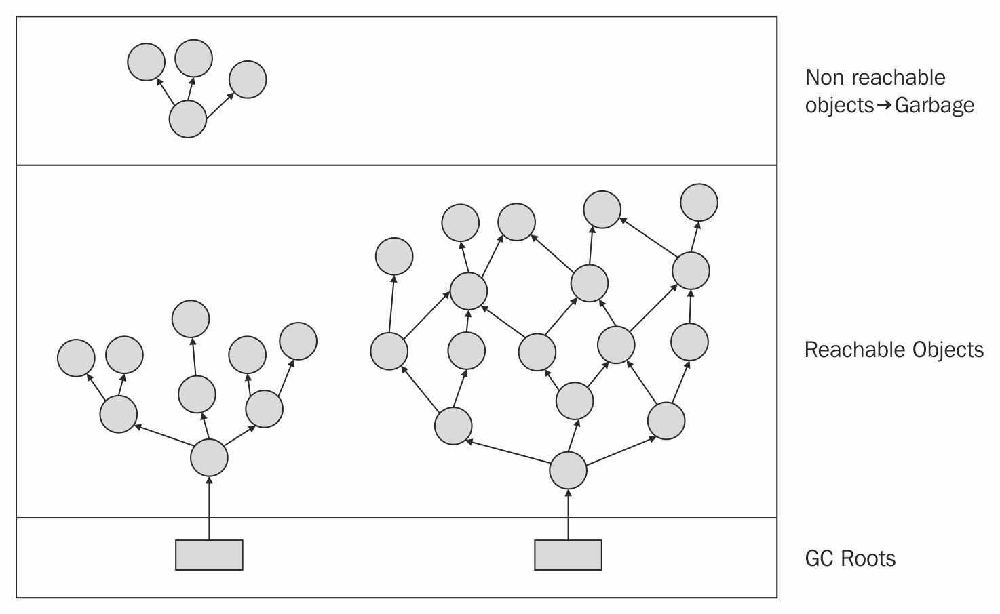
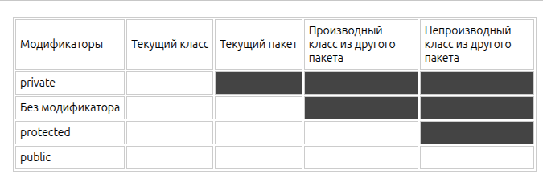
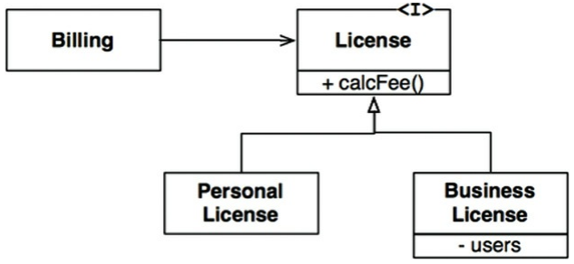
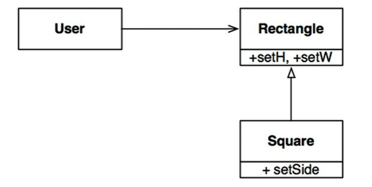
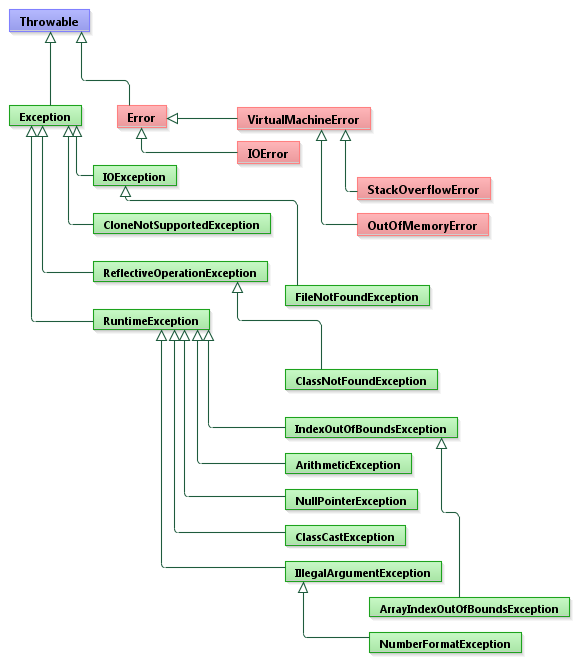

## *Содержание*

1. Фундаментальные типы данных. Целочисленные типы, представление отрицательных чисел. Числа с плавающей точкой, их двоичное представление. Символьный и логический типы. Явные и неявные приведения типов. Перегрузка функций.
2. Области памяти. Стек, куча, статическая память. Ошибка “stack overflow”. Понятие сборщика мусора и основные принципы его работы.
3. Классы. Объекты. Поля, методы. Конструкторы. Ключевое слово this. Статические члены класса. Модификаторы доступа, инкапсуляция. Внутренние классы, локальные классы, их особенности и примеры.
4. Наследование. Преобразования типов между родителем и наследником. Переопределение методов у наследника. Абстрактные классы. Интерфейсы. Принцип подстановки Лисков.
5. Исключения. Иерархия исключений. Проверяемые и непроверяемые исключения. Конструкция try with resources.
6. Обобщенные классы. Обобщенные методы: объявление и вызов. Наследование обобщенных классов. Wildcards, верхние и нижние границы. PECS. Bounded type.
7. Стандартные коллекции: ArrayList, LinkedList, HashMap, TreeMap, LinkedHashMap. Их основные методы и внутреннее устройство.
8. Лямбда-функции. Элементы функционального программирования. Захват окружения. Ссылки на методы.
9. Optional. Stream API. Промежуточные и терминальные операции. Коллекторы, комбинации коллекторов. Создание своего коллектора.
10. Аннотации. Объявление и применение аннотаций. Мета-аннотации @Target, @Retention. Параметры аннотаций.
11. Рефлексия. Примеры использования. Рефлексия применительно к дженерикам. Методы для доступа к конструкторам, полям, методам и аннотациям. Инициализация поля, вызов метода через reflection.
12. JVM. Байт-код. ClassLoader: что это такое, из чего состоит, для чего нужны разные?
13. Основы многопоточности. Потоки (threads). Создание и завершение потоков. Проблема race condition. Мьютексы и их использование.
14. Модель памяти. Проблема гонки данных и ее решение. Отношение happens-before. Ключевые слова synchronized и volatile.
15. Асинхронное программирование. Блокирующие и неблокирующие операции. Классы Future и CompletableFuture.

___
## 1. Фундаментальные типы данных. Целочисленные типы, представление отрицательных чисел. Числа с плавающей точкой, их двоичное представление. Символьный и логический типы. Явные и неявные приведения типов. Перегрузка функций.

В Java типы данных делятся на **примитивные** и **ссылочные**. Примитивные переменные хранят непосредственно значение, а переменные ссылочных типов – ссылку на объект или `null`.

Всего существует **8 примитивных типов**:
- `byte` – 8 бит, целое число от -128 до 127.
- `short` – 16 бит, целое число от -32768 до 32767.
- `int` – 32 бита, целое число от -2³¹ до 2³¹ − 1.
- `long` – 64 бита, целое число от -2⁶³ до 2⁶³ − 1.
- `float` – 32 бита, число с плавающей точкой.
- `double` – 64 бита, число с плавающей точкой.
- `char` – 16 бит, беззнаковая единица кодирования UTF-16 (от 0 до 65535).
- `boolean` – логический тип: `true` или `false`. Размер хранения не определён спецификацией Java.

**Память JVM (упрощённая модель):**
- **Stack** – хранит кадры вызовов методов, в том числе локальные переменные (примитивы и ссылки).
- **Heap** – хранит объекты и массивы.

На практике JVM может оптимизировать размещение данных.

Java использует **pass by value**: при передаче аргументов в метод копируются их значения. Для примитивов – само значение, для ссылочных типов – значение ссылки. Поэтому метод может изменить состояние переданного объекта, но не может заменить ссылку у вызывающего кода.

### Целочисленные типы

`byte`, `short`, `int` и `long` – целочисленные типы со знаком. Для представления отрицательных чисел применяется **дополнительный код (two's complement)**.

На примере `byte` (8 бит):

| Число | Двоичное представление |
| ----- | ---------------------- |
| 127   | `01111111`             |
| 5     | `00000101`             |
| -5    | `11111011`             |
| -1    | `11111111`             |
| -128  | `10000000`             |
То есть старший бит имеет вес $-128$, остальные положительные.

**Особенности:**

- `byte` часто применяется для хранения бинарных данных, например в `byte[]`.
- `int` – основной тип для целочисленных вычислений.
- `long` применяется для больших чисел. Суффикс литерала – `L`, например `long n = 10L;`.
- При обычных арифметических операциях `byte`, `short` и `char` продвигаются до `int`, если нет операнда более широкого типа.

```Java
byte a = 1;
byte b = 2;

int result = a + b;        // OK, результат int
byte sum = (byte) (a + b); // OK, явное приведение
byte error = a + b;        // Ошибка компиляции
```

### Числа с плавающей точкой

`float` и `double` используют стандарт **IEEE 754** (`binary32` и `binary64` соответственно). Число представляется через знак, экспоненту (порядок) и дробную часть мантиссы, т.е. $(-1)^s × (1.f)_2 × 2^E$, где `s` – бит знака, `f` – дробная часть, `E` – беззнаковая экспонента.

| Характеристика    | `float`          | `double`             |
| ----------------- | ---------------- | -------------------- |
| Размер            | 32 бита          | 64 бита              |
| Знак              | 1 бит            | 1 бит                |
| Экспонента        | 8 бит            | 11 бит               |
| Дробная часть     | 23 бита          | 52 бита              |
| Точность          | ~7 значащих цифр | ~15-16 значащих цифр |

**Пример двоичного представления** `5.75` **в** `float`**:** $5.75 = 101.11_2 = 1.011_2 × 2^2$, знак – 0, экспонента – 10000001, мантисса – 01110000000000000000000

**Особенности:**
- Литералы: `1.1f` – `float`, `1.1` или `1.1d` – `double`.
- Можно также использовать научную нотация для литералов: например `1.1e-3` означает `0.0011`.
- Существуют положительный и отрицательный нули: `+0.0`, `-0.0`.
- Специальные значения: `Infinity`, `-Infinity`, `NaN`.
- Некоторые десятичные дроби (например, `0.1`) нельзя представить точно в двоичной системе, поэтому возникают ошибки округления.

```Java
double a = 1.0 / 0.0; // Infinity
double b = 0.0 / 0.0; // NaN
double c = Math.sqrt(-1); // NaN

int x = 1 / 0; // ArithmeticException
```

Для нулей, бесконечностей, `NaN` и субнормальных чисел в IEEE 754 предусмотрены специальные правила представления.

### Символьный и логический типы

`boolean` хранит только `true` или `false`. Размер его представления в памяти зависит от реализации JVM и не фиксирован спецификацией Java. Не поддерживает числовые преобразования.

`char` – 16-битный беззнаковый тип, представляющий одну единицу кодирования UTF-16.

```Java
char symbol = 'f';
symbol = 102;       // Числовое значение
symbol = '\u0066';  // Unicode escape
```

`char` участвует в арифметических операциях с числовым продвижением до `int`:

```Java
char c = 'A'; // 65
int next = c + 1; // 66
```

### Явные и неявные преобразования типов

При взаимодействии типов с разной разрядностью возникают ситуации несоответствия, которые Java разрешает либо автоматически, либо требует вмешательства программиста (явное приведение).

Автоматические преобразования (**неявные**, расширение, **widening**) выполняются по следующим цепочкам:


Стрелками на рисунке показано, какие преобразования типов могут выполняться автоматически. Пунктирными стрелками показаны автоматические преобразования с потерей точности.

Внутри арифметических выражений происходит *продвижение типов*. Java всегда подтягивает аргументы к "старшему" типу перед вычислением:
- Если есть хоть один `double`, всё станет `double`.
- Иначе, если есть `float`, всё станет `float`.
- Иначе, если есть `long`, всё станет `long`
- `byte`, `short` и `char` изначально преобразуются в `int`

Для сужающих (они же **явные**, **narrowing**) преобразований требуется явное приведение `(тип)`. При этом возможна потеря данных:

```Java
long a = 100L;
int b = (int) a;

int x = 258;
byte y = (byte) x; // 2
```

При преобразовании `int -> byte` сохраняются младшие 8 бит, которые затем интерпретируются как знаковое число.

```
258 (int): 00000000 00000000 00000001 00000010
                                               
Младшие 8 бит: 00000010 = 2
```

Другие примеры:

```
(byte) 130  // -126
(byte) 128  // -128
(byte) 256  // 0
```

*Исключение*: компилятор разрешает присвоить константное выражение типа `int` переменной `byte`, `short` или `char` без явного приведения, если значение помещается в диапазон.

```
byte a = 100; // OK

int x = 100;
byte b = x;   // Ошибка компиляции
```

Кроме того, Java поддерживает автоматическую упаковку (`boxing`) примитивов в классы-обёртки и распаковку (`unboxing`), например `int <-> Integer`.

### Перегрузка методов

**Перегрузка (overloading)** – возможность использовать одно имя для нескольких методов с различными сигнатурами. Это проявление статического полиморфизма: подходящая перегрузка выбирается на этапе компиляции по типам аргументов.

Методы могут различаться *количеством, типами и порядком типов параметров*.

```
class Calculator {
    int sum(int a, int b) {
        return a + b;
    }

    double sum(double a, double b) {
        return a + b;
    }

    double sum(double a, double b, long c) {
        return a + b + c;
    }
}
```

Использование:

```
Calculator calc = new Calculator();

calc.sum(2, 3);        // sum(int, int)
calc.sum(2.3, 3.2);    // sum(double, double)
calc.sum(2.3, 3.2, 4); // sum(double, double, long)
```

*Тип возвращаемого значения не участвует в различении перегрузок*. Следующие методы нельзя одновременно объявить в одном классе:

```
int sum(int a, int b) {
    return a + b;
}

double sum(int a, int b) { // Ошибка компиляции
    return a + b;
}
```

Перегружаться могут как методы, объявленные в одном классе, так и унаследованные методы.
___

## 2. Области памяти. Стек, куча, статическая память. Ошибка “stack overflow”. Понятие сборщика мусора и основные принципы его работы.

### Области памяти

Память JVM можно условно разделить на три области: **стек**, **кучу** и **статическую память**, которой в спецификации JVM соответствует **область методов** (method area). В стеке хранятся фреймы вызовов методов с локальными переменными (примитивами и ссылками), в куче – объекты и массивы, в области методов – данные загруженных классов.


#### Стек (Stack), ошибка `java.lang.StackOverflowError`

Каждый поток имеет собственный **стек**, организованный по принципу LIFO: при вызове метода на его вершину помещается новый фрейм, а при завершении метода фрейм снимается.

Фрейм содержит массив локальных переменных (включая параметры метода и `this` для нестатических методов), стек операндов для вычислений байт-кода и ссылку на пул констант класса. Память фрейма освобождается сразу при выходе из метода, без участия сборщика мусора.

Размер стека потока ограничен и задаётся параметром JVM `-Xss`. Если для нового фрейма не хватает места (как правило, из-за слишком глубокой или бесконечной рекурсии), JVM выбрасывает `java.lang.StackOverflowError`.

#### Куча

**Куча** – общая для всех потоков область памяти, в которой размещаются объекты и массивы. Память в ней выделяется при создании объектов и освобождается сборщиком мусора; если места не хватает даже после сборки, выбрасывается `OutOfMemoryError`. Поколенческие сборщики делят кучу на поколения: большинство объектов живут недолго, поэтому молодые объекты выгодно собирать чаще и отдельно от долгоживущих.

- **Молодое поколение (Young Generation)** – сюда попадают новые объекты. Состоит из области Eden и двух областей выживших (Survivor): S0 и S1.
- **Старое поколение (Old Generation)** – сюда перемещаются объекты, пережившие заданное число сборок в молодом поколении.

#### Область методов

**Область методов** – общая для всех потоков область, где хранятся данные загруженных классов: описания полей и методов, байт-код, пул констант времени выполнения (runtime constant pool) и статические переменные. Эти данные существуют, пока загружен класс, а не в течение жизни отдельного объекта или вызова метода.

Реализация области методов зависит от JVM. В HotSpot до Java 8 для этого использовалась область **PermGen** (Permanent Generation) фиксированного размера, которая нередко переполнялась (`OutOfMemoryError: PermGen space`). Начиная с Java 8 её заменила **Metaspace** в нативной памяти за пределами кучи: она расширяется по мере загрузки классов, а максимальный размер ограничивается параметром `-XX:MaxMetaspaceSize`. При этом значения статических полей и пул строк в современных версиях HotSpot хранятся в куче.

### Понятие сборщика мусора и основные принципы его работы

**Garbage Collector (GC)** – механизм автоматического управления памятью JVM, который находит недостижимые объекты в куче и освобождает занимаемую ими память. Объект считается живым, если до него существует цепочка ссылок от **GC Roots** – корневых ссылок: локальных переменных в активных фреймах всех потоков, статических полей загруженных классов, ссылок из нативного кода (JNI) и т. п.



В упрощённом виде работу трассирующего сборщика описывает алгоритм **Mark-Sweep**:

- **Mark (маркировка)** – обход графа объектов от GC Roots и пометка всех достижимых объектов;
- **Sweep (очистка)** – освобождение памяти, занятой непомеченными объектами.

В отличие от подсчёта ссылок, такой подход корректно обрабатывает циклические ссылки: группа объектов, ссылающихся друг на друга, но недостижимых от GC Roots, будет удалена.

#### Minor GC

**Minor GC** – сборка мусора в молодом поколении; запускается, когда в Eden не хватает места для нового объекта. Сборщик копирует живые объекты из Eden и текущей Survivor-области во вторую, пустую Survivor-область, после чего исходные области освобождаются целиком; при следующей сборке Survivor-области меняются ролями. Каждая пережитая сборка увеличивает возраст объекта, и по достижении порога (`-XX:MaxTenuringThreshold`) объект перемещается в старое поколение. Minor GC выполняется часто, но быстро: её стоимость пропорциональна числу живых объектов, а большинство молодых объектов к моменту сборки уже недостижимы.


#### Major GC

**Major GC** – сборка мусора в старом поколении. После удаления мёртвых объектов свободная память оказывается разбита на разрозненные участки (фрагментация), поэтому многие сборщики выполняют **уплотнение (compaction)**: сдвигают живые объекты в непрерывную область и обновляют ссылки на них. Major GC выполняется реже Minor GC, но длится дольше: старое поколение больше и содержит больше живых объектов, а их перемещение затратно. Сборку всей кучи называют **Full GC** (термины Major и Full GC часто смешивают).

Сборка мусора, в том числе Minor GC, целиком или на отдельных фазах сопровождается паузами **Stop-The-World**, во время которых потоки приложения приостановлены. Современные сборщики (G1, ZGC, Shenandoah) выполняют большую часть работы параллельно с приложением, чтобы сократить эти паузы.

___
## 3. Классы. Объекты. Поля, методы. Конструкторы. Ключевое слово this. Статические члены класса. Модификаторы доступа, инкапсуляция. Внутренние классы, локальные классы, их особенности и примеры.

### Классы и объекты

**Класс** – пользовательский тип данных, описывающий состояние объектов (**поля**) и их поведение (**методы**). **Объект** – экземпляр класса. Он создаётся оператором `new`, который выделяет память в куче, вызывает конструктор и возвращает ссылку на объект.

```Java
class Person {
    String name; // поля
    int age;

    void print() { // метод
        System.out.printf("%s, %d%n", name, age);
    }
}

Person p = new Person();

p.name = "Alice"; // обращение к членам объекта через точку

p.print();
```

Поля, в отличие от локальных переменных, не требуют явной инициализации: они получают значения по умолчанию – `0`, `0.0`, `'\u0000'`, `false` или `null` в зависимости от типа.

### Конструкторы

**Конструктор** – специальный метод, который инициализирует создаваемый объект. Имя конструктора совпадает с именем класса, возвращаемого типа у него нет.

```Java
class Person {
    private String name;
    private int age;

    Person(String name, int age) {
        this.name = name;
        this.age = age;
    }

    Person(String name) {
        this(name, 0); // вызов другого конструктора
    }
}

```

**Особенности:**
- Если в классе нет ни одного конструктора, компилятор добавляет **конструктор по умолчанию**: без параметров, с модификатором доступа класса, вызывающий `super()`. Если объявлен хотя бы один конструктор, конструктор по умолчанию не создаётся.
- Конструкторы можно перегружать, но они не наследуются.
- Конструктор начинается с вызова конструктора родителя `super(...)` (если вызов не написан явно, подставляется `super()`) или другого конструктора своего класса `this(...)`. Затем выполняются инициализаторы полей и блоки инициализации `{ ... }`, затем тело конструктора.

### Ключевое слово this

`this` – ссылка на текущий объект. Используется:
- для обращения к полю, перекрытому параметром или локальной переменной: `this.name = name`;
- для вызова другого конструктора того же класса: `this(...)`;
- для передачи текущего объекта в метод или возврата его из метода: `return this`.

Вызов `this(...)` допустим только в конструкторе и должен быть его первой инструкцией (начиная с Java 25 перед ним разрешён код, не обращающийся к создаваемому объекту).

### Статические члены класса

Члены с модификатором `static` принадлежат классу, а не объекту. Статическое поле существует в одном экземпляре, общем для всех объектов. Статический метод вызывается через имя класса без создания объекта, например `Math.abs(x)`. Статический блок выполняется один раз при инициализации класса, то есть при первом активном использовании: создании объекта, вызове статического метода или обращении к статическому полю (кроме констант времени компиляции).

```Java
class Person {
    static int count;          // одно на все объекты
    static int retirementAge;

    static {                   // статический блок инициализации
        retirementAge = 65;
    }

    int age;                   // у каждого объекта своё

    Person(int age) {
        this.age = age;
        count++;
    }

    static boolean isRetired(Person p) { // статический метод
        return p.age >= retirementAge;
    }
}

Person.isRetired(new Person(70)); // true
System.out.println(Person.count); // 1
```

### Модификаторы доступа, инкапсуляция

**Инкапсуляция** – объединение данных и методов работы с ними в одном классе с сокрытием деталей реализации. Внешний код взаимодействует с объектом только через открытые методы и не может в обход них привести его в некорректное состояние.

Инкапсуляция реализуется **модификаторами доступа**:



**Особенности:**
- `private`-член доступен только внутри класса верхнего уровня, в котором он объявлен, – в том числе из всех вложенных в него классов (и наоборот: внешний класс видит `private`-члены вложенных).
- Класс верхнего уровня может быть только `public` или package-private. В файле допускается не более одного `public`-класса верхнего уровня, и имя файла должно совпадать с его именем.
- Наследник из другого пакета обращается к `protected`-членам родителя только через ссылки своего типа (включая `this`), но не через ссылку на объект родителя.

```Java
public class BankAccount {
    private long balance; // недоступно снаружи

    public long getBalance() {
        return balance;
    }

    public void deposit(long amount) {
        if (amount <= 0) {
            throw new IllegalArgumentException("amount must be positive");
        }

        balance += amount;
    }
}
```

### Внутренние и локальные классы

**Внутренний класс** – нестатический класс, объявленный в теле другого класса. **Локальный класс** – класс, объявленный внутри метода, конструктора или блока кода. Класс-член, объявленный с `static`, называется **статическим вложенным** и внутренним не является: он не связан с объектом внешнего класса.

```Java
public class Outer {
    private int value = 10;
    private static int count = 5;
  
    class Inner {
        private int value = 20;

        void print() {
            System.out.println(value); // 20 – поле Inner
            System.out.println(Outer.this.value); // 10 – поле Outer
        }
    }
    
    static class Nested {
        void print(Outer outer) {
            System.out.println(count); // статическое поле Outer – напрямую
            System.out.println(outer.value); // нестатическое – только через ссылку
        }
    }

    void method(int delta) {
        int base = 5;

        class Local {
            int sum() {
                return value + base + delta; // поле Outer и локальные переменные
            }
        }

        System.out.println(new Local().sum());
    }
}

Outer outer = new Outer();
Outer.Inner inner = outer.new Inner(); // нужен объект внешнего класса

inner.print();
outer.method(1); // 16
```

**Особенности внутренних классов:**
- Объект внутреннего класса хранит неявную ссылку на объект внешнего (`Outer.this`), поэтому создаётся только через него: `outer.new Inner()`, а в нестатических методах `Outer` – просто `new Inner()`. Через эту ссылку ему доступны все поля и методы внешнего объекта.
- Статические члены во внутренних классах разрешены с Java 16, до этого – только константы.
- Неявная ссылка не даёт сборщику мусора удалить внешний объект, пока жив внутренний, и это может привести к утечке памяти. Если доступ к внешнему объекту не нужен, используют статический вложенный класс.
- Применение: класс, тесно связанный с объектом внешнего класса, например итератор коллекции (`ArrayList.Itr`).

**Особенности статических вложенных классов:**
- Не хранит ссылку на объект внешнего класса: создаётся без него (`new Outer.Nested()`), а к нестатическим членам внешнего класса обращается только через ссылку на объект.
- По сути это обычный класс, помещённый внутрь другого для группировки и ограничения доступа: в отличие от класса верхнего уровня, он может быть `private` или `protected`.
- Применение: вспомогательный класс, которому не нужен объект внешнего класса, например узел списка (`LinkedList.Node`) или Builder.

**Особенности локальных классов:**
- Виден только внутри своего блока; не может иметь модификаторов доступа и `static`.
- В нестатическом методе связан с объектом внешнего класса так же, как внутренний; в статическом – видит только статические члены.
- Может использовать локальные переменные и параметры метода, только если они `final` или *effectively final* (не изменяются после инициализации). Объект локального класса может пережить вызов метода, поэтому получает копию значения переменной. Изменять переменную запрещено, чтобы копия и оригинал не расходились.
- Применение: вспомогательный класс, нужный только в одном методе.

___
## 4. Наследование. Преобразования типов между родителем и наследником. Переопределение методов у наследника. Абстрактные классы. Интерфейсы. Принцип подстановки Лисков.

**Наследование (inheritance)** – механизм ООП, позволяющий создать новый класс на основе существующего: наследник получает доступный ему функционал родителя и может расширять или изменять поведение. Отношение наследования обычно описывают как **is-a** ("собака является животным").

В Java для наследования класса используется ключевое слово `extends`:

```Java
class Animal {
    protected String name;

    Animal(String name) {
        this.name = name;
    }

    void speak() {
        System.out.println("Some sound");
    }
}

  

class Dog extends Animal {
    Dog(String name) {
        super(name); // вызов конструктора родителя
    }

    @Override
    void speak() {
        System.out.println("Woof");
    }

    void fetch() {
        System.out.println(name + " fetches the ball");
    }
}
```

**Особенности:**
- Класс в Java может наследоваться только от **одного класса**. Если `extends` не указан, непосредственным родителем обычного класса считается `Object`.
- **Конструкторы не наследуются**. При создании наследника вызывается конструктор родителя: через явный `super(...)` или неявный `super()` (если это допустимо). Если у родителя нет доступного конструктора без аргументов, подходящий конструктор нужно вызвать явно.
- Наследник не может напрямую обращаться к `private`-членам родителя; они остаются частью состояния объекта, но недоступны по имени из кода наследника.
- `super.method()` вызывает реализацию метода родителя, а `super(...)` – его конструктор. В Java 25 разрешены некоторые инструкции перед явным вызовом конструктора (`super(...)` / `this(...)`); раньше они должны были стоять первыми.
- Класс с модификатором `final` нельзя наследовать.

### Преобразования типов между родителем и наследником

**Восходящее приведение (upcasting)** – преобразование ссылки на наследника к типу родителя. Выполняется *неявно*, так как каждый объект наследника одновременно является объектом родительского типа.

```Java
Animal animal = new Dog("Rex"); // upcasting
animal.speak(); // Woof: реализация выбирается по реальному типу объекта

// animal.fetch(); // Ошибка компиляции: в Animal нет метода fetch()
```

Здесь *статический тип ссылки* – `Animal`, а *фактический тип объекта* – `Dog`. Статический тип определяет, какие члены доступны на этапе компиляции; фактический тип определяет, какая реализация переопределённого нестатического метода будет вызвана. Сам объект при приведении не изменяется.

**Нисходящее приведение (downcasting)** – явное преобразование ссылки родительского типа к типу наследника. Успешно только тогда, когда фактический объект совместим с целевым типом:

```Java
Animal animal = new Dog("Rex");
Dog dog = (Dog) animal; // OK
dog.fetch();

Animal other = new Animal("Unknown");
Dog invalid = (Dog) other; // ClassCastException во время выполнения
```

Проверить тип перед приведением помогает оператор `instanceof`:

```Java
if (animal instanceof Dog) {
    Dog d = (Dog) animal;
    d.fetch();
}

// Pattern matching for instanceof (стандартная возможность с Java 16)
if (animal instanceof Dog d) {
    d.fetch();
}
```

**Важно:** `ClassCastException` возникает при несовместимом приведении во время выполнения; заведомо несовместимые типы компилятор может отклонить ещё до запуска программы.

### Переопределение методов у наследника

**Переопределение (override)** – объявление в наследнике экземплярного метода, заменяющего унаследованную реализацию. Это основа *динамического полиморфизма*: конкретная реализация выбирается во время выполнения по фактическому типу объекта.

В примере выше `Dog.speak()` переопределяет `Animal.speak()`. Аннотация `@Override` не обязательна, но позволяет компилятору проверить, что переопределение действительно произошло.

**Правила переопределения:**
- Имя и типы параметров должны соответствовать методу родителя; другой список параметров означает *перегрузку*, а не переопределение.
- Возвращаемый тип должен совпадать либо быть *ковариантным* (более конкретным ссылочным типом). Для примитивных возвращаемых типов это правило не работает.
- Нельзя снижать уровень доступа: `protected` можно заменить на `public`, но не на `private`.
- Нельзя объявить более широкие *проверяемые* исключения, чем разрешает метод родителя.
- `final`-методы переопределять нельзя; `private`-методы не переопределяются, поскольку недоступны для наследования.
- `static`-методы не переопределяются, а скрываются (*method hiding*). В отличие от обычных методов, выбор вызываемого `static`-метода происходит на этапе компиляции по статическому типу ссылки, а не по фактическому типу объекта.

```Java
class Parent {
    void print() {
        System.out.println("Parent");
    }
}

class Child extends Parent {
    @Override
    void print() {
        super.print(); // Parent
        System.out.println("Child");
    }
}

Parent ref = new Child();
ref.print(); // Parent, затем Child
```

### Абстрактные классы

**Абстрактный класс** (`abstract`) – класс, экземпляр которого нельзя создать напрямую. Он может содержать **поля, конструкторы, обычные методы** и **абстрактные методы** – объявления методов без тела.

```Java
abstract class Shape {
    private final String color;
    
    protected Shape(String color) {
        this.color = color;
    }

    public abstract double area(); // нет реализации

    public void describe() { // общая реализация
        System.out.println(color + ": " + area());
    }
}

class Circle extends Shape {
    private final double radius;

    Circle(double radius) {
        super("red");
        this.radius = radius;
    }

    @Override
    public double area() {
        return Math.PI * radius * radius;
    }
}

Shape shape = new Circle(2); // OK: ссылка на абстрактный тип
shape.describe();
// Shape other = new Shape("red"); // Ошибка компиляции
```

**Особенности:**
- Если класс содержит хотя бы один абстрактный метод, он обязан быть `abstract`. Но абстрактный класс может *не иметь* абстрактных методов.
- Конкретный (неабстрактный) наследник обязан реализовать все доступные ему абстрактные методы. Абстрактный наследник может оставить их без реализации.
- Абстрактный метод нельзя объявить одновременно `private`, `static` или `final`.
- Абстрактный класс не может быть `final`: один модификатор требует наследования для конкретной реализации, а второй запрещает его.

### Интерфейсы

**Интерфейс (interface)** – контракт, задающий набор операций, которые обязаны поддерживать реализующие его классы. Для реализации используется `implements`. *Один класс может реализовать несколько интерфейсов*, а интерфейс может наследовать несколько других интерфейсов через `extends`.

```Java
interface Payable {
    double amount(); // неявно public abstract

    default String description() { // реализация по умолчанию
        return "Payment: " + amount();
    }

    static boolean isValid(double value) {
        return value >= 0;
    }
}

interface Auditable {
    void audit();
}

class Invoice implements Payable, Auditable {
    private final double total;

    Invoice(double total) {
        this.total = total;
    }

    @Override
    public double amount() {
        return total;
    }

    @Override
    public void audit() {
        System.out.println("Invoice checked");
    }
}

Payable invoice = new Invoice(120);
System.out.println(invoice.description()); // Payment: 120.0
```

**Особенности интерфейсов:**
- Обычные методы без тела неявно `public abstract`; при реализации их нельзя сделать менее доступными.
- Интерфейс может содержать методы `default`, `static`, а также `private`-вспомогательные методы (с Java 9). `static`-метод вызывается через имя интерфейса.
- Все поля интерфейса неявно `public static final`; полей состояния экземпляра и конструкторов у интерфейса нет.
- Если два реализуемых интерфейса предоставляют конфликтующие `default`-методы с одной сигнатурой и конфликт не разрешён более конкретным правилом наследования, класс должен явно переопределить метод.

| Абстрактный класс | Интерфейс |
| --- | --- |
| Наследуется через `extends` | Реализуется через `implements` |
| Только один прямой родительский класс | Можно реализовать несколько интерфейсов |
| Может хранить состояние объекта в полях | Нет полей состояния экземпляра |
| Может иметь конструкторы | Не имеет конструкторов |
| Подходит для общей реализации и состояния | Подходит для описания общего контракта |

### Принцип подстановки Лисков

*По материалам главы 9 книги Роберта Мартина «Чистая архитектура».*

В 1988 году Барбара Лисков написала следующие строки с формулировкой определения подтипов:
	*Если для каждого объекта o1 типа S существует какой-то объект o2 типа T, что для всех программ P, определённых в типах T, поведение P не изменяется при подстановке o1 вместо o2, то S является подтипом T.*

Проще говоря: объекты подтипа должны быть взаимозаменяемы с объектами базового типа без нарушения обещанного клиентскому коду поведения.

**Пример архитектуры, соблюдающей этот принцип**:



```Java
interface License {
    long calcFee();
}

class PersonalLicense implements License {
    @Override
    public long calcFee() {
        return 1000;
    }
}

class BusinessLicense implements License {
    private final int users;

    BusinessLicense(int users) {
        if (users < 1) {
            throw new IllegalArgumentException();
        }
        this.users = users;
    }

    @Override
    public long calcFee() {
        return 500L * users;
    }
}

class Billing {
    void bill(License license) {
        long amount = license.calcFee();
        System.out.println("К оплате: " + amount);
    }
}
```

Есть интерфейс License. В нём определён метод calcFee(), который вызывается приложением Billing. Существует два "подтипа" класса License: PersonalLicense и BusinessLicense. Они реализуют разные алгоритмы расчёта лицензионных отчислений. Оба подтипа могут служить заменой для типа License.

**Пример архитектуры, нарушающей этот принцип**:

Классическим нарушением принципа подстановки может служить известная проблема квадрат/прямоугольник.



С математической точки зрения квадрат является частным случаем прямоугольника, поэтому кажется логичным определить `Square` как наследника `Rectangle`. Однако если `Rectangle` позволяет независимо изменять ширину и высоту, такое наследование нарушает LSP. Дело в том, что у квадрата стороны всегда должны оставаться равными: изменение одной стороны требует изменения другой.

Предположим, что клиентский код работает с объектом `Rectangle`:

```Java
Rectangle r = ...;
r.setW(5);
r.setH(2);
assert (r.area() == 10);
```

Клиент рассчитывает, что изменение высоты не влияет на ширину. Если вместо экземпляра базового класса придёт экземпляр `Square`, этот контракт будет нарушен: при изменении высоты квадрат должен также изменить ширину, поэтому проверка `assert` не пройдёт. Чтобы обойти проблему, клиентскому коду пришлось бы проверять, является ли прямоугольник квадратом, и обрабатывать его отдельно. Однако тогда поведение клиента начинает зависеть от конкретного подтипа, а значит, объекты уже не являются взаимозаменяемыми.

Важно, что проблема возникает именно из-за контракта изменяемого прямоугольника. Если стороны задаются при создании объекта и впоследствии не изменяются, `Square` вполне может быть корректным подтипом `Rectangle`.

**Практические правила LSP:**
- Наследник *не должен усиливать предусловия*: требовать от аргументов больше, чем базовый контракт.
- Наследник *не должен ослаблять постусловия*: гарантировать меньше, чем обещает базовый контракт.
- Наследник *должен сохранять инварианты базового типа* и не добавлять неожиданные сбои для корректного по контракту использования.

___
## 5. Исключения. Иерархия исключений. Проверяемые и непроверяемые исключения. Конструкция try with resources.

**Исключение (exception)** – объект, описывающий нештатную ситуацию, возникшую во время выполнения программы. Например, файл может отсутствовать, аргумент метода – оказаться некорректным, а обращение к массиву – выйти за его границы.

При возникновении исключения обычное выполнение кода прерывается. Java ищет подходящий обработчик `catch`: сначала в текущем методе, затем в вызывающих методах по стеку вызовов. Если исключение нигде не обработано, завершается поток, в котором оно возникло (но не обязательно вся программа).

### Обработка исключений: `try`, `catch`, `finally`

Для перехвата исключений используется конструкция `try...catch...finally`:

```Java
try {
    int result = 10 / 0;
    System.out.println(result); // не выполнится
} catch (ArithmeticException e) {
    System.out.println("Деление на ноль: " + e.getMessage());
} finally {
    System.out.println("Завершение обработки");
}
```

- **`try`** – блок кода, при выполнении которого может возникнуть исключение.
- **`catch`** – обработчик исключения подходящего типа. При возникновении исключения оставшаяся часть `try` пропускается, а управление переходит к первому подходящему `catch`.
- **`finally`** – блок, выполняемый при выходе из `try`/`catch` независимо от того, произошло ли исключение (в том числе обычно при `return`). Используется для завершающих действий; при аварийном завершении JVM выполнение не гарантируется.

Можно использовать `try` с одним или несколькими `catch`, с одним `finally` либо с `catch` и `finally` одновременно. Обычный `try` без `catch` и `finally` недопустим; исключение – `try-with-resources`, которому они не обязательны.

**Особенности:**
- Несколько `catch` проверяются сверху вниз: обработчики более конкретных типов должны идти раньше обработчиков их родителей. Например, `catch (FileNotFoundException e)` должен стоять перед `catch (IOException e)`.
- С Java 7 можно объединять несвязанные типы исключений в одном обработчике: `catch (IOException | SQLException e)` (*multi-catch*).
- `finally` не должен содержать `return` или ненужное выбрасывание новых исключений: это может скрыть исходную ошибку.
- У объекта исключения можно получить сообщение (`getMessage()`), причину (`getCause()`) и трассировку стека (`printStackTrace()`).

### `throw` и `throws`

Оператор **`throw`** создаёт ситуацию выбрасывания конкретного исключения. Например, так можно запретить некорректное значение аргумента:

```Java
static void setAge(int age) {
    if (age < 0) {
        throw new IllegalArgumentException("Возраст не может быть отрицательным");
    }
}
```

Ключевое слово **`throws`** указывается в сигнатуре метода и объявляет, какие проверяемые исключения метод может передать вызывающему коду:

```Java
static String readText(Path path) throws IOException {
    return Files.readString(path);
}
```

Здесь `IOException` не обрабатывается внутри `readText`, поэтому вызывающий код должен либо перехватить его через `try...catch`, либо также объявить через `throws`. Объявлять непроверяемые исключения в `throws` разрешено, но компилятор этого не требует.

### Иерархия исключений

В Java оператор `throw` позволяет выбрасывать объекты класса `Throwable` и его наследников. Сам `Throwable` наследуется от `Object`.



- **`Error`** – серьёзные проблемы среды выполнения, от которых приложение обычно не пытается восстанавливаться. Примеры: `OutOfMemoryError`, `StackOverflowError`.
- **`Exception`** – базовый класс для исключительных ситуаций, которые приложение потенциально может обработать. Важно: его потомки бывают как проверяемыми, так и непроверяемыми.
- **`RuntimeException`** – базовый класс для непроверяемых исключений, часто связанных с нарушением предположений программы: `NullPointerException`, `IllegalArgumentException`, `ArithmeticException`.

Обычно пользовательские проверяемые исключения наследуют от `Exception`, а непроверяемые – от `RuntimeException`. Напрямую наследоваться от `Throwable` не принято.

### Проверяемые и непроверяемые исключения

**Проверяемые исключения (checked exceptions)** – все наследники `Throwable`, кроме `RuntimeException`, `Error` и их подклассов. Компилятор требует, чтобы код, который может выбросить такое исключение, либо обработал его (`catch`), либо указал в `throws` соответствующего метода.

**Непроверяемые исключения (unchecked exceptions)** – `RuntimeException`, `Error` и все их наследники. Обрабатывать и объявлять их необязательно, хотя перехватывать их можно.

| | Checked | Unchecked |
| --- | --- | --- |
| Примеры | `IOException`, `SQLException`, `InterruptedException` | `NullPointerException`, `IllegalArgumentException`, `OutOfMemoryError` |
| Проверка компилятором | Требуется `catch` или `throws` | Не требуется |
| Типичный смысл | Ожидаемая проблема, с которой вызывающий код может справиться | Ошибка в использовании API, нарушение инварианта либо серьёзный сбой JVM |
### Конструкция try-with-resources

**try-with-resources** – конструкция Java (с Java 7), которая автоматически закрывает ресурсы по окончании блока `try`, даже если внутри возникло исключение. Ресурс должен реализовывать интерфейс `AutoCloseable`, у которого есть метод `close()`. Интерфейс `Closeable`, применяемый, например, в потоках ввода-вывода, расширяет `AutoCloseable`.

```Java
try (BufferedReader reader = Files.newBufferedReader(Path.of("data.txt"))) {
    System.out.println(reader.readLine());
} catch (IOException e) {
    System.out.println("Ошибка чтения файла: " + e.getMessage());
}
```

После выхода из `try` у `reader` автоматически вызывается `close()`. Это освобождает связанные с ресурсом системные средства (например, файловый дескриптор). Сборщик мусора сам по себе не заменяет своевременное закрытие файлов, сокетов или соединений.

Можно объявить несколько ресурсов через `;`:

```Java
try (InputStream in = Files.newInputStream(Path.of("input.txt"));
     OutputStream out = Files.newOutputStream(Path.of("output.txt"))) {
    in.transferTo(out);
} catch (IOException e) {
    System.out.println(e.getMessage());
}
```

**Особенности:**
- Ресурсы инициализируются слева направо, а **закрываются в обратном порядке**: в примере сначала `out`, затем `in`.
- Если создание одного из ресурсов завершится исключением, уже успешно созданные ресурсы будут закрыты.
- `catch` и `finally` необязательны: допустим `try (Resource r = ...) { ... }` без них, если требования к обработке проверяемых исключений выполнены.
- С Java 9 можно указывать и ранее созданную переменную, если она `final` или *effectively final* (её значение не меняется после присваивания).  

**Подавленные исключения (suppressed exceptions).** Если исключение возникло и в теле `try`, и при закрытии ресурса, основным остаётся исключение из тела `try`, а ошибка из `close()` прикрепляется к нему как подавленная. Их можно получить методом `getSuppressed()`. Это позволяет не потерять первоначальную причину ошибки. Если в теле `try` исключений не было, ошибка закрытия сама может стать основным исключением.

___
